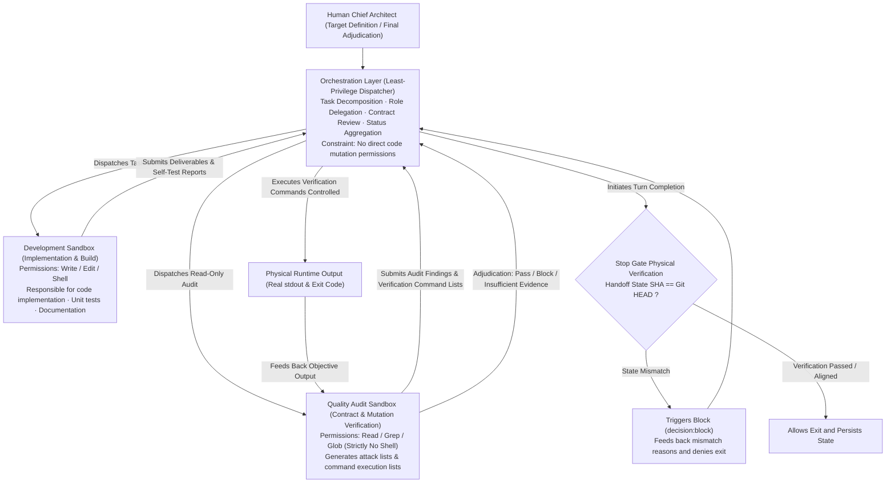

# AI Collaboration Framework

[中文](README.md) · **English**

[](./CLAUDE.md)
[](./GEMINI.md)
[](./LICENSE)
[](./examples/web3-koliance)
[](./packages/agent-guard)
[](./packages/agent-guard)

> **Document Baseline**: This framework designates the **Chinese documentation as the Single Source of Truth (SSOT)**. English documentation (`README.en.md` / `AGENTS.en.md`) serves as a linguistic projection; in case of discrepancies, the Chinese version prevails (under Discipline D4).
>
> **Status Baseline**: Enterprise-proven; includes an enterprise production showcase with 900+ passed automated tests (`examples/web3-koliance/`) and a standard quality guard toolkit (`packages/agent-guard/`).
> This repository is not merely a collection of agent prompts, but an engineered implementation of **runtime contract testing, mutation testing gates, least-privilege execution sandboxes, and context lifecycle governance**.

---

## 1. Problems Solved

When introducing large language models (LLMs) and autonomous agents into production-grade software engineering, systemic collapses rarely stem from insufficient model intelligence. Instead, they arise from predictable **structural failure modes**:

| Structural Failure Mode | Typical Observable Symptom | Framework Governance Mechanism |
| --- | --- | --- |
| **Inference Over Observation** | Speculating runtime behavior based on file or symbol names; reporting scheduled tasks as completed | **D1 Runtime Truth Grounding**: Mandates verification against physical stdout and read-only assertions; isolates build/cache noise |
| **Stage Boundary Permeability** | Writing business implementation before architectural designs are reviewed; declaring releases without tests | **D2 Hard Stage Gates**: Multi-stage state machine with strict exit criteria that halt progress when unmet |
| **False All-Green & Empty Denominators** | 0 executed tests misconstrued as 100% success; assertions with only positive paths failing silently | **D3 Mutation Testing Gates**: Enforces negative fault injection and substantive assertion audits to stop silent passes |
| **State Drift & Dual Realities** | Root cause analyses never written back to specs; context bloating causing memory drift across turns | **D4 SSOT & Context Lifecycle GC**: Atomic state overwrites, tombstone markers, and automated log pruning |
| **Role Overreach & Privilege Creep** | A single agent acting as architect, developer, and tester; orchestrator mutating code directly | **Least-Privilege Sandboxes & Separation of Concerns**: Physical decoupling of execution, generation, and auditing; shell stripped from auditors |

The engineering principle of this framework: **These structural failures cannot be solved by textual prompt requests; they require deterministic code gates, sandbox boundaries, and executable guards.**

---

## 2. Core Cognitive Model

Complex engineering lifecycles are located across an orthogonal two-dimensional coordinate system:

```text
Vertical (System Layer)       Rules -> Organization -> Business -> System -> Code -> Runtime -> Data -> Experience
Horizontal (Lifecycle Stage)  Initiation -> Requirements -> Design -> Development -> Testing -> Release -> Deployment -> Observability -> Troubleshooting -> Recovery -> Postmortem -> Automation
```

Before initiating any physical operation, the orchestrator agent must assert two facts:
"Which lifecycle stage and which architectural layer does this request target?"
Based on this grid coordinate, the orchestrator binds the exact role contract, input constraints, and exit acceptance criteria.

---

## 3. Topology and Control Flow: Least-Privilege Execution Sandbox and Separation of Concerns

The framework eliminates reliance on single agents acting without checks, enforcing **least-privilege sandboxes and decoupled responsibilities**:



### Four Engineering Laws of Responsibility Separation

1. **Decoupling Dispatch from Implementation**: The orchestrator agent decomposes, delegates, reviews, and adjudicates, but never writes code directly. If a required role is absent, it halts and requests intervention rather than silently downgrading to "doing it itself".
2. **Mechanically Enforced Read-Only Auditing**: Auditor roles (`qa-validator`, `gate-auditor`, `falsifier`) have tool access strictly limited to `Read`, `Grep`, `Glob`. Shell execution and file creation tools are stripped, closing backdoors where scripts write to disk.
3. **Command Proxying and Objective Feedback**: Because read-only auditors cannot run commands, they produce an attack list and a command list. The orchestrator runs these commands in a controlled runner and feeds back raw stdout and exit codes for unbiased evaluation.
4. **Physical Stop Gate**: Before a turn concludes, a Stop Hook compares the Git Commit SHA recorded in the state ledger against `git rev-parse --short HEAD`. Any divergence triggers `decision:block`, preventing incomplete handoffs.

---

## 4. Four Non-Negotiable Engineering Disciplines (Zero Tolerance)

### D1 · Runtime Observability and Truth Grounding
All conclusions and architectural decisions must rely on **actually read physical files** or **real stdout/stderr outputs from runtime commands**, never on symbol names or conjecture.
File discovery and denominator calculations **strictly use `git ls-files`** to isolate `node_modules`, build caches, and untracked artifacts from corrupting metrics. All timestamps follow the UTC ISO-8601 standard.

### D2 · Hard Stage Gates
Engineering progresses strictly in sequence. **Before exit criteria of the preceding stage are met, generating implementation code for subsequent stages is blocked**.
When a gate fails, explicit blocking causes and resolution criteria must be emitted; proceeding with "we will fix it later" is forbidden.

### D3 · Mutation Testing Gates and Anti-Silent Pass
All automated tests, watchdogs, and monitoring probes **must possess substantive assertion power capable of failing under mutation**:
- Empty test functions containing only `pass` or docstrings are blocked;
- Tautological assertions (e.g., `assert True`, `assert 1 == 1`, `expect(true).toBe(true)`) are blocked;
- Empty denominators (0 tests discovered or executed) misidentified as 100% green are blocked;
- Quality and security gates must be verified via negative fault injection: deliberately introduced faults **must reliably trigger failures**, proving the gate is active.

### D4 · Single Source of Truth (SSOT) and Context Lifecycle Governance
Global identifiers adhere to strict prefixes: `ADR-` (Architecture Decision), `MIG-` (Database Migration), `GAP-` (Quality Gap), `INC-` (Incident Postmortem), `DEFER-` (Technical Debt).
When conclusions are reached (especially incident root causes), they must be written back to downstream specifications immediately. In long-running agent conversations, Context Garbage Collection (Context GC) trims verbose logs, extracts canonical state assertions, and registers tombstones for deprecated technical choices to prevent hallucination.

---

## 5. Ten-Stage Quality Gate Matrix

For enterprise projects built with this framework, the ten lifecycle stages operate as **hard gates**:

| Stage | Gate Type | Entry and Exit Acceptance Criteria | Verification Evidence |
| --- | --- | --- | --- |
| **01 Design** | Hard Gate | ADR committed; schema migrations have monotonic timestamps; acceptance criteria are measurable | Static document review and contract verification |
| **02 Development** | Hard Gate | Implementation adheres strictly to spec; change ledger updated prior to commit; no debug backdoors | Static type-checking and linter reports |
| **03 Testing** | Hard Gate | New tests integrated into CI; coverage meets configured thresholds; substantive assertion audit passed | `agent-guard check --stage test-audit` · CI Matrix |
| **04 Build** | Hard Gate | Container images pinned to immutable sha256 digests; runtime assertion `REVISION == Git HEAD` | Image signatures and manifest metadata |
| **05 Deployment** | Hard Gate | Deployment scripts are strictly idempotent (consecutive runs yield identical hash); configurations aligned | Idempotency sandbox rehearsal logs |
| **06 Observability** | Hard Gate | Multi-tier alerting configured; simulated outage drills successfully trigger active alerts | Chaos drill logs and alert records |
| **07 Troubleshooting** | Hard Gate | Second-resolution timeline constructed; controlled experiments conducted; root cause written back to docs | RCA postmortem markdown |
| **08 Recovery** | Hard Gate | Disaster recovery drills meet measured RTO/RPO; business consistency checks pass | DR audit records and ledger balance reports |
| **09 Postmortem** | Hard Gate | Action items have physical tracking artifacts, assigned owners, and verifiable Definition of Done | Incident postmortem index and tracking issues |
| **10 Automation** | Hard Gate | Scheduled jobs assert preconditions before execution; executions generate independent archived reports | Automation execution logs and audit reports |

---

## 6. Standard Utility Package: `agent-guard`

The framework's core gating and context governance mechanisms are packaged in `packages/agent-guard/`, implemented entirely with the Python 3.10+ standard library without external dependencies.

### Key Capabilities

1. **Multi-Stage Quality Gates (`gates.py`)**:
   - Inspects workspace preconditions (clean git status, no unresolved merge conflict markers `<<<<<<<`, baseline documentation in place);
   - Performs AST-based (Python) and lexical (TS/JS) analysis on test suites to detect empty test bodies (`pass` / docstring only), tautologies (`assert True`, `expect(true).toBe(true)`), and zero-test denominators.
2. **Context Lifecycle Pruner (`context_gc.py`)**:
   - Strips ephemeral progress indicators, noisy spinners, and verbose compilation logs;
   - Distills compact Canonical State Assertions (e.g., `[STATE_ASSERTION:test] unittest_status={"status": "PASSED", "tests": 20}`);
   - Manages Single Source of Truth (SSOT) state tracking with atomic overwrites to eliminate multi-turn memory drift;
   - Enforces a Tombstone Registry that catches references to rejected architectural options.
3. **Enterprise CLI (`cli.py`)**:
   - `check`: Audits workspace gate health and test assertion validity;
   - `prune`: Compresses verbose logs and outputs canonical assertions;
   - `init`: Generates `.agent-guard.json` configuration and pre-commit hook scripts.

### Installation

```bash
# Install in editable mode
pip install -e packages/agent-guard

# Or invoke directly as a Python module
python3 -m agent_guard.cli --help
```

### CLI Usage Examples

#### 1. Audit Quality Gates (`agent-guard check`)

```bash
# Audit all gates across the workspace
agent-guard check --path . --stage all

# Audit test assertions only with JSON output
agent-guard check --path . --stage test-audit --json
```

Sample output:
```text
=== agent-guard quality gate scan: /path/to/project ===
[PASS] Stage: PRE-ACTION | Code: PRE_ACTION_GATE_PASSED
       Message: Workspace preconditions satisfied: no merge conflicts and baseline files intact.
[PASS] Stage: TEST-AUDIT | Code: ASSERTION_AUDIT_PASSED
       Message: Audited 42 files with 932 tests and 1420 assertions. 0 critical issues found.
--------------------------------------------------
[RESULT] All quality gates PASSED.
```

#### 2. Prune Verbose Logs (`agent-guard prune`)

```bash
# Prune verbose build logs and check against tombstones
agent-guard prune --input test_run.log --tombstones "ads_power,legacy_auth"

# Distill canonical state assertions only
agent-guard prune --input test_run.log --extract-assertions
```

Sample output:
```text
[STATE_ASSERTION:process] command_exit_code=0
[STATE_ASSERTION:test] vitest_status={"status": "PASSED", "passed": 48}
[STATE_ASSERTION:vcs] git_working_tree="clean"
```

#### 3. Initialize Project Configuration and Git Hooks (`agent-guard init`)

```bash
# Generate .agent-guard.json and install git pre-commit hook
agent-guard init --path . --install-hook
```

---

## 7. Enterprise Verification Evidence: 900+ Automated Tests

This framework is proven through complex commercial and hackathon production deployments:

### 1. Production Showcase: `examples/web3-koliance/`
The repository includes a complete Web3 decentralized derivatives and quantitative trading platform (`examples/web3-koliance/`, backwards-compatible with `koliance/`):
- **Smart Contracts**: EVM perpetual contracts, liquidation engine, and oracle pricing feeds;
- **Full-Stack Application**: Next.js 14 App Router client, resilient backend routing, and session management;
- **Matching Engine**: High-performance Rust matching crate and benchmark suite;
- **Automated Test Suite**: Over 40 test modules with **900+ passing automated tests** verifying API envelopes, geographical failover, zero synthetic quotes, and multi-layer data consistency.

Run the showcase test suite:
```bash
cd examples/web3-koliance
pnpm test
```

### 2. Toolkit Test Suite: `packages/agent-guard/tests/`
The `agent-guard` package includes 20 comprehensive automated unit tests covering AST parsing, assertion auditing, context pruning, SSOT state management, and CLI commands:

```bash
python3 -m unittest discover -s packages/agent-guard/tests -p 'test_*.py' -v
```

Execution result:
```text
Ran 20 tests in 0.014s
OK (100% Passed, Exit Code 0)
```

---

## 8. Three-Layer Role Contracts

Role contracts are structured in three distinct layers:

| Layer | Location | Contract Purpose | Review Timing |
| --- | --- | --- | --- |
| **Layer 1: Template** | [`prompts/角色契约.md`](prompts/角色契约.md) Part 1 | Defines the 9 essential elements of any role: mission, scope, inputs, workflow, authority, outputs, criteria, escalation, metrics | Framework permanent |
| **Layer 2: Registry** | [`prompts/角色契约.md`](prompts/角色契约.md) Part 2 | Authoritative registry of approved roles and their input/output contracts | Prior to dispatch |
| **Layer 3: Implementation** | [`.claude/agents/`](.claude/agents/) | Concrete subagent configurations: scope, boundary rules, and allowed `tools` | Mounted at runtime |

### Core Approved Roles (10 Classes)

- `biz-strategist` Business Architecture Strategist
- `pm-spec-driver` Product & Specification Driver
- `system-architect` Distributed Systems Architect
- `data-engineer` Storage & Pipeline Engineer
- `backend-dev` Backend Engineering Specialist
- `qa-validator` Chaos & Quality Assurance Engineer
- `security-auditor` Security Compliance & Penetration Auditor
- `sre-operator` Site Reliability & Operations Engineer
- `postmortem-analyst` Incident & Engineering Postmortem Analyst
- `automation-builder` Workflow Automation Engineer

### Read-Only Auditor Sandbox Fencing

Concrete read-only auditor subagents include:
- [`falsifier`](.claude/agents/falsifier.md) Mutation and negative validation auditor (read-only)
- [`gate-auditor`](.claude/agents/gate-auditor.md) Stage gate exit auditor (read-only)

Auditors are restricted to `Read`, `Grep`, and `Glob` tools, with shell execution strictly withheld.

---

## 9. Repository Map

```text
ai-collaboration-framework/
├── README.md                           # Chinese documentation (Single Source of Truth, SSOT)
├── README.en.md                        # English linguistic projection
├── AGENTS.md                           # Unified cross-runtime role and gate specification
├── CLAUDE.md                           # Claude Code runtime entrypoint
├── GEMINI.md                           # Antigravity runtime entrypoint
├── LICENSE                             # Apache 2.0 License
├── packages/
│   └── agent-guard/                    # Quality gate and context GC package
│       ├── agent_guard/
│       │   ├── __init__.py
│       │   ├── gates.py                # Multi-stage gates & AST assertion auditing
│       │   ├── context_gc.py           # Context GC, SSOT state, & tombstones
│       │   └── cli.py                  # CLI entrypoint (check / prune / init)
│       ├── tests/
│       │   └── test_agent_guard.py     # Comprehensive automated tests (100% passed)
│       ├── pyproject.toml              # Packaging configuration
│       └── setup.py                    # Setup configuration
├── examples/
│   ├── README.md                       # Showcase documentation
│   └── web3-koliance -> ../koliance   # Web3 production showcase (900+ tests passed)
├── koliance/                           # Full-stack Web3 application (contracts, app, Rust)
├── .claude/
│   ├── agents/                         # Claude subagent configurations
│   └── hooks/                          # Guardian hook scripts
├── .agents/
│   └── hooks.json                      # Antigravity hook bindings
└── prompts/
    ├── AI总控.md                       # Master orchestrator system prompt
    ├── 角色契约.md                     # Role templates and registry
    └── 全生命周期工程质量总监.md        # Ten-stage pipeline specifications
```

---

## 10. Dual Runtime Zero-Intrusion Adaptation

The framework provides native, zero-intrusion support across modern agent environments:

| Runtime Environment | Entrypoint | Mounting Mechanism |
| --- | --- | --- |
| **Claude Code CLI** | [`CLAUDE.md`](CLAUDE.md) | Automatically mounts `.claude/agents/*.md`; enforces read-only boundaries via `tools: Read, Grep, Glob` |
| **Google Antigravity IDE** | [`GEMINI.md`](GEMINI.md) | Automatically discovers `GEMINI.md` and `AGENTS.md`; attaches hooks via `.agents/hooks.json`; defines subagents via `define_subagent` |

---

## 11. Contributing & Quality Standards

Pull requests must satisfy the following acceptance criteria:
1. `agent-guard check --path . --stage all` exits with code 0 without empty or tautological assertions;
2. New Python code adheres to Python 3.10+ standard library specifications without external dependencies;
3. Documentation updates maintain Chinese as the SSOT, with synchronized updates to `README.md` and `README.en.md`;
4. Diagrams use only supported Mermaid types (`flowchart TD`, `sequenceDiagram`) with quoted node text.

---

## 12. License

This project is licensed under the [Apache License 2.0](LICENSE).
