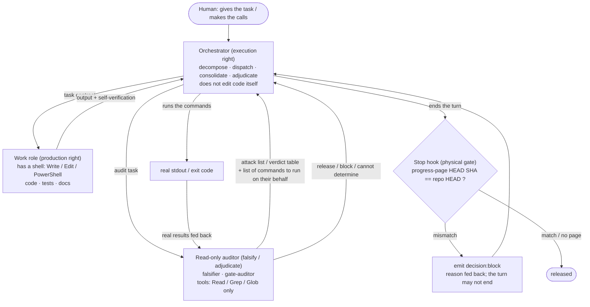
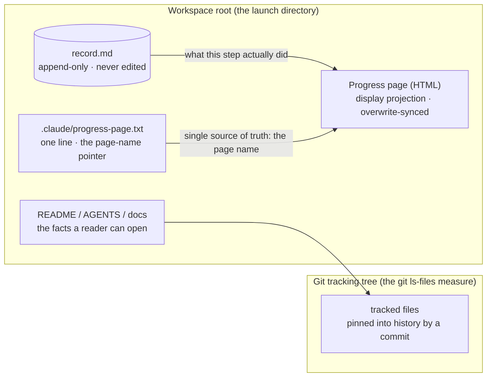

# AI Collaboration Engineering Framework

[中文](README.md) · **English**

[](./CLAUDE.md)
[](./GEMINI.md)


> **Documentation baseline**: this framework treats **Chinese as the single source of truth
> (SSOT)**; the English documents (`README.en.md` / `AGENTS.en.md`) are a **language projection**.
> Where they disagree, **the Chinese version wins** (D4).
>
> **Status stated honestly**: **Experimental**, **no version tag** (`git tag` measures empty).
> This repo is the **template** — having no artefacts for stages 04/06–10 is a **property of a
> template**, **not a "failure"**; it is **still bound by disciplines D1–D4 and the mechanical
> guards** (see §5).

> A **constraint framework** for "one human + several AIs developing real software projects."
> It does not teach an AI how to write code — it constrains the **order**, the **evidence**,
> and the **boundaries** within which an AI produces, and makes every deliverable leave a
> **reviewable trace**.

This repository is neither a project scaffold nor a prompt collection. It is the
**mechanisation of engineering discipline**: it turns four non-negotiable disciplines —
*read it before you claim it, hard stage gates, falsifiable criteria, single source of truth* —
into four executable things: a **gate matrix, role contracts, a runtime-state contract,
and mechanical guards**.

---

## 1. What problem it solves

When you put an AI to work, the failure is rarely "the model isn't smart enough." It is
usually one of these **structural failures**:

| Failure mode | Typical symptom | The framework's mechanism |
| --- | --- | --- |
| **Inference instead of measurement** | Guessing runtime behaviour from a component/file name; reporting "planned" as "done" | Discipline D1 |
| **Stages blurring together** | Writing business code before the design is locked; declaring "shippable" with no test gate | Gate matrix + D2 (hard stage gates) |
| **Fake all-green** | An empty denominator read as 100%; a criterion that is **silent on failure** | D3 (criteria must be falsifiable) |
| **Two facts of different maturity** | A root cause never written back to the design docs; a progress page permanently behind HEAD | D4 (SSOT) + mechanical guard |
| **Role overreach / silent downgrade** | A generic subagent standing in for a missing specialist; the orchestrator doing the work itself | Three-layer role contracts + registry |

The framework's position: **these failures cannot be fixed by "reminding the AI to be careful."
Only mechanisms fix them.** So the most important parts here are not the written disciplines
but the **falsifiable criteria** and the **hooks that actually block**.

---

## 2. The core cognitive model

Tasks are located on a two-dimensional coordinate system:

```
Vertical (system layers)   Rules → Organisation → Business → System → Code → Runtime → Data → Experience
Horizontal (lifecycle)     Inception → Requirements → Design → Development → Test → Release
                           → Deploy → Operate → Incident → Iterate → Decommission
```

Together these form a matrix. On receiving a task, the orchestrator AI first answers **two
questions**: *"Which stage, which layer?"* — only then does it decide whom to summon, what
input to give, and what output to demand.

Alongside the horizontal axis sit business and engineering constraints: cost, supply chain and
protocols, ecosystem extension, organisational governance, risk, security, reliability,
business value.

> The full prompt is [`prompts/AI总控.md`](prompts/AI总控.md) (Chinese).

---

## 3. Topology and control flow: separation of three powers

The framework does not rely on "the AI remembering to be careful." It relies on **mutually
exclusive permissions plus one physical gate**:



**Four points that matter**:

| Point | Content |
| --- | --- |
| **Execution right ≠ production right** | The orchestrator **does not edit code**; whoever edits code is a work role. When a role is missing the task **stops** (no silent downgrade) rather than "the orchestrator does it itself" |
| **Read-only is mechanical** | The read-only auditors' `tools` **contain no shell at all** — a shell is itself a write backdoor (`Set-Content` can write to disk, delete files); blocking `Write` / `Edit` **does not block it** |
| **Run-on-behalf → feed back → judge on the facts** | Read-only roles **cannot run commands**, so they produce an **attack list + a command list**; the orchestrator **runs them on their behalf** and feeds back the **real stdout**, and they **judge on the facts**. This is an **explicit division of labour, not a downgrade**; its crack ("did the run-on-behalf actually happen" has no criterion today) is registered as `GAP-005` |
| **The physical gate does not rely on the model** | Before the turn ends, the Stop hook compares the **HEAD SHA recorded in the progress page** against `git rev-parse --short HEAD` and emits `decision:block` on mismatch — **a reminder gets ignored; a block does not** (mechanism in §9) |

**Who reviews whom is a hard rule**: on finishing each lifecycle stage you must dispatch,
in order, `qa-validator` → `falsifier` → `gate-auditor` (**a three-hop chain; missing one hop
means you may not advance**). **Self-written self-verification by the implementer is not a
stage-03 exit.**

> 📄 **The rules live in `AGENTS.md`**: role layer and dispatch **§4** · the three-hop chain
> **§4.2** · runtime state and the Stop hook **§5**. This section is only a **projection of the
> topology**; where it disagrees with `AGENTS.md`, **`AGENTS.md` wins**.
>
> The repo's `prompts/AI协同工程架构.png` draws an **earlier fan-out view** (orchestrator →
> parallel agents → runtime artefacts) and does **not** show the read-only audit or the
> physical gate. It is **not a source of rules** — read this section for the topology.

---

## 4. The four non-negotiable disciplines (Zero Tolerance)

### D1 · Read it before you claim it — never infer
Every conclusion must rest on **content actually read from a file** or **real command stdout**.
File and counting metrics **must use `git ls-files`** — to isolate build artefacts and dependencies.
(This is not fastidiousness: in a real project the `find` count was **531** files and the
`git ls-files` count was **252** — a difference of **279**, all build artefacts and local files.
Use the wrong measure and every "coverage" or "file count" conclusion is false.)
Timelines are always asserted in **UTC**.

### D2 · Hard stage gates
Advance strictly in order. **Until the previous stage's exit criteria are met, do not generate
the next stage's implementation.**
When blocked, **state the blocking reason and the release condition** — not "I'll start it now
and fill it in later."

### D3 · Criteria must be falsifiable
When writing any monitor, scheduled job, assertion, or gate script, you **must also provide a
negative test case**: inject a fault and the alert/failure **must** fire.
**Be especially wary of criteria that are "silent on failure"** — such criteria (hooks, guard
scripts) look perfectly healthy while never blocking anything if a path derivation is wrong.
For these, verification **must** run the negative case. "Silent when consistent" is **not**
enough to prove teeth — it cannot distinguish "normal" from "dead code."

### D4 · Single source of truth (SSOT) and drift-proof identifiers
Identifiers are strictly defined: `ADR-` (architecture decision) · `MIG-` (database migration) ·
`GAP-` (quality gap) · `INC-` (production incident) · `DEFER-` (deferred debt).
Any conclusion (especially a root cause) **must be written back immediately** to the downstream
design and product documents. **Two facts of different maturity must never coexist.**
On conflict: **in-repo docs > out-of-repo docs**; **code and measurement > prose**.
**Search before registering a new gap** — `git grep` the whole repo to confirm no existing
identifier already covers it. **Colliding with an existing identifier is worse than not
registering at all.**

> The source disciplines (with the ten-stage pipeline's entry/exit checkpoints) are in
> [`prompts/全生命周期工程质量总监与系统架构师.md`](prompts/全生命周期工程质量总监与系统架构师.md) (Chinese).

---

## 5. The gate matrix

Ten pipeline stages, **all hard gates** — failing any stage's exit criteria **blocks** the next.
**When the corresponding artefact does not exist, the stage is judged "not met" — not "not applicable."**
This matrix constrains **projects that adopt the framework**; **the framework repo itself (this
repo) is a template and is not subject to it** (this repo is still bound by D1–D4 and the
mechanical guards).

| Stage | Nature | Exit criteria |
| --- | --- | --- |
| **01 Design** | 🔒 Hard gate | ADR on disk + schema migration with timestamp + acceptance criteria testable |
| **02 Development** | 🔒 Hard gate | Follows `docs/changes` *write-first-fill-later* + consistent naming |
| **03 Test** | 🔒 Hard gate | New cases **100% enrolled in the CI matrix** + coverage **configured threshold** |
| **04 Build** | 🔒 Hard gate | Immutable image **digest** + runtime assertion `REVISION == Git HEAD` |
| **05 Deploy** | 🔒 Hard gate | Deploy script **idempotent end to end** + config/env vars aligned both ways, no residue |
| **06 Observability** | 🔒 Hard gate | Alertmanager `active` distinguished + severity participates + real downtime drill |
| **07 Incident** | 🔒 Hard gate | Second-level timeline + controlled experiment + root cause written back + actions → GAP |
| **08 Recovery** | 🔒 Hard gate | Measured RTO/RPO + **business-level** availability verification |
| **09 Retrospective** | 🔒 Hard gate | Action items have an owner form / dependencies / measurable DoD |
| **10 Automation** | 🔒 Hard gate | Timer precondition assertions + independently archived report |

> Full matrix in [`AGENTS.md`](AGENTS.md) §2 (**Chinese is the baseline**; its English
> projection is [`AGENTS.en.md`](AGENTS.en.md)); the per-stage **handover chain** is in
> **`AGENTS.md` §4.2 lifecycle advance**. The two must be read together.

---

## 6. Role contracts come in three layers (none may be skipped)

This is the single **most commonly misunderstood** point in the framework: equating
"role contract" with `.claude/agents/*.md` is wrong — that is only the third layer.

| Layer | File | What it defines | When to read |
| --- | --- | --- | --- |
| **Template** | [`prompts/角色契约.md`](prompts/角色契约.md) part 1 | The **9 items** a role must state: mission / scope / inputs / workflow / decision rights / output contract / acceptance criteria / escalation / metrics | Always resident |
| **Registry** | [`prompts/角色契约.md`](prompts/角色契约.md) part 2 | **Which roles exist** + each one's **input/output contract** | **Mandatory before dispatching** |
| **Implementation** | [`.claude/agents/`](.claude/agents/) | The roles **instantiated in this project**: scope / hard boundaries / iron rules / `tools` allow-list | Loaded with the subagent |

### Roles in the registry (10)

`biz-strategist` · `pm-spec-driver` · `system-architect` · `data-engineer` · `backend-dev` ·
`qa-validator` · `sre-operator` · `sec-auditor` · `finops-controller` · `rca-investigator`

All ten now ship **baseline contract implementations** covering the full lifecycle.
**Domain-specific roles** (e.g. `contract-dev` for a web3 project) are added per project —
see ledger `DEFER-006`.

### Implementations that are not registry roles

The registry lists **business roles**. The following three are **enforcers of the disciplines**
and are not among those ten:

| Implementation | Discipline served |
| --- | --- |
| [`ssot-scribe`](.claude/agents/ssot-scribe.md) docs & ledger maintenance | D4 SSOT |
| [`gate-auditor`](.claude/agents/gate-auditor.md) gate audit (read-only) | D2 hard stage gates |
| [`falsifier`](.claude/agents/falsifier.md) negative verification (read-only) | D3 falsifiability |

> **"Read-only" is mechanical, but the criterion is *not* "no Write/Edit"**:
> `falsifier` / `gate-auditor` have `tools` of **`Read` / `Grep` / `Glob` only** — **no shell at all**.
> The reason: **shell is itself a write backdoor** — `Set-Content` / `Out-File` / `Remove-Item`
> can all write and delete files, so blocking `Write`/`Edit` alone **does not block it** —
> that would be a **criterion crack** (the same shape as §11, "two doors, running one leaks").
> **The cost is explicit**: read-only roles **cannot run commands**, so their execution is
> **carried out by the orchestrator on their behalf** — they produce **attack lists / verdict
> tables + command lists**, and the orchestrator feeds back **real stdout** before they judge.

### Hard constraints on dispatching subagents

| Constraint | Content |
| --- | --- |
| **Concurrency cap** | No more than **3** roles summoned concurrently for a single task |
| **Registry-only** | **A role not in the registry may not be dispatched** (no vague roles) |
| **Mandatory cross-review** | Architecture/scheme changes must be **summoned in pairs** to review each other; cross-examination capped at **2 rounds**; if unresolved, escalate the disagreement to a human |
| **State consolidation** | **Subagents must not modify the runtime memory** — the orchestrator distils it into a ≤5-line summary |
| **No silent downgrade** | If a role is unavailable (unregistered / missing), **you must say so explicitly**; **never** quietly switch to "the orchestrator will do it" or substitute a generic subagent |
| **Decision routing** | At a decision point, **never stand still waiting**, and **never** quietly do as you please — if the decision is **non-essential** (reversible + in-repo + **not an exemption**) then **execute the recommendation**, leaving **one line in `record.md`** and marking it as a recommendation; if **essential**, **record it and skip**, then move on to the next task. **Criterion ③'s enumeration is an example, not a closed set**, and **any recommendation whose effect is to skip a check this framework requires always takes route ②**. **Without that trace, ① and "quietly doing as you please" are observationally identical** |
| **Task-location protocol** | **Before acting**: ① **restate** (one sentence, written for the user) ② **place it** (lifecycle stage × system layer) ③ **acknowledge** (the user corrects it on the spot if wrong). **Restating is not asking permission — it is declaring your understanding**: except for irreversible actions or an explicit request to hold off, **restate then start**, or the protocol itself becomes "standing still waiting". Criterion = "**corrected once**" — countable, hence falsifiable (ledger `GAP-027`) |

> The last two are the most commonly violated. **"No silent downgrade" has a cost** — it means
> that when a role is missing, **the task stops** rather than "getting finished somehow."
> The framework holds that this cost must be paid: output outside the hard boundary is
> **not accepted**, and **re-dispatching is cheaper than rework**.
>
> **"Decision routing" is its mirror image** — it governs **when to keep moving rather than stop**:
> merely listing options and stopping is exactly where "the user issues the same instruction again"
> comes from; quietly doing the irreversible things that were the human's to decide is the error in
> the opposite direction. Both share one root cause: **there was no line saying what must stop and
> what must proceed**. **The line is here**: **an unavailable role = hard boundary, you must stop**;
> **an everyday decision = routed by the three criteria (reversible / in-repo / not an exemption)**.
> The rule **expressly forbids** treating "execute the recommendation" as a **gate exemption** —
> D2 and the §2 gate matrix are **either satisfied or blocking, with no third path**.

---

## 7. The physical-fact layer: five places where "what actually happened this turn" lives



| Place | What it is | Who writes it / how it changes | Tracked |
| --- | --- | --- | --- |
| **Workspace root** | The launch directory; the framework resolves its three lookup paths upwards from it | Determined by **where you launch** (the launcher locks it) | — |
| **Git tracking tree** | The tracked files under `git ls-files` — **the mandated measure**, isolating build artefacts and dependencies | `git add` with explicit file paths, then commit | ✅ |
| **`record.md`** | The **source** of the behaviour record: one command-level line per action, **existing lines never edited or deleted** | Append-only | ⬜ runtime state, kept out of commits (see `.gitignore`) |
| **Progress page (HTML)** | The **human-facing projection**: status / case counts / coverage / ledger / timeline | **Overwrite**-synced | ⬜ as above |
| **`.claude/progress-page.txt`** | **One line** giving the page's filename — **the single source of truth for the page name** | Renaming the page = editing this line | ✅ |

**How they cooperate (one sentence)**: `record.md` answers "**what did this step actually do**",
the progress page answers "**where are we overall now**" — they are **two projections of the same
record** and must be updated **in the same turn**; update only one and the other becomes a
**fact of a different maturity** (D4). The criterion **does not rely on good intentions**: the
Stop hook reads **the name from the pointer file** and compares the page's HEAD SHA against the
repo HEAD (mechanism in §9).

> **Why the page name goes through a pointer**: the page gets **renamed** as a project advances.
> Hard-code the name in a script or a doc and one rename **silently disables** it — and "silent"
> is exactly what it looks like when it works.

---

## 8. File map of this repository

```
AGENTS.md                        The single source of constraints. Disciplines / gate matrix /
                                 five-segment protocol / role-layer definition
AGENTS.en.md                     The same, in English (a language projection of one source of rules)
CLAUDE.md                        Claude Code thin entry point: import AGENTS.md + declare identity + self-check
GEMINI.md                        Antigravity thin entry point: @[label](path) pre-loading + identity + self-check
README.en.md                     This file
LICENSE                          MIT

prompts/
  AI总控.md                      Orchestrator prompt (2-D model: 8 layers × 11 stages)
  角色契约.md                     Role contracts: template (9 items) + registry (12 roles)
  全生命周期工程质量总监与系统架构师.md   Source disciplines (four + ten-stage checkpoints)
  AI协同工程架构.png              Topology diagram (**an earlier fan-out view**; for the current
                                 topology see §3)

.claude/
  settings.json                  Claude Code Stop hook config
  hooks/check-progress.ps1       Progress-page staleness guard (fail-closed, see §9)
  hooks/check-numbers.ps1        Cross-branch identifier-collision guard (see §9)
  hooks/README.md                Guard implementation detail (read on demand)
  progress-page.txt              One line: the single source of truth for the page filename
  agents/*.md                    Instantiated roles (**12 business roles + 3 discipline enforcers**)

.agents/
  hooks.json                     Antigravity lifecycle hooks config (PreInvocation + Stop)
  hooks/inject-agents-tail.ps1   AGENTS.md >24KB dynamic multi-chunk loader (zero-intrusion, future-proof)
  hooks/stop-adapter.ps1         Stop guard protocol adapter (reuses .claude/hooks/*.ps1 directly)

launchers/
  start_claude.bat / .sh         Launchers: lock the working directory

docs/
  ledger.md                      The **only** ledger of open items (GAP/INC/DEFER).
                                 **Anything "not yet done" that is not in the ledger does not exist**
  ledger-evidence/               The ledger's **evidence appendices** (A–D: pre-registration
                                 searches / evidence transcripts / verification commands / guard
                                 measurements). **Not read by default — open on demand**; the
                                 ledger body points here only when something needs re-checking
  reference-implementations.md    Ten-stage reference implementations: what each stage's exit
                                 looks like in a real production repo (read on demand)
  delivery-gates.md              Delivery-path details: the pre-commit local gate; the
                                 "instructions to be executed" class of document (read on demand)
  drift-cases.md                 Drift actually caught during the rollout (a snapshot; read on demand)
  adopting.md                    **Adopting the framework**: the per-stage "language socket" table,
                                 the minimal three-step bootstrap, the project checklist
  guard-self-test.md             Isolated-sandbox self-test of the progress-page guard:
                                 two copy-paste negative cases + the measured readings
  known-issues.md                **Maturity assessment & systemic known-issues analysis**:
                                 measured profile of four problem domains + convergence roadmap
```
> ⚠️ **Layouts differ, and this repo is "self-hosted"**: the repo is the directory that
> **contains `.git`** (any name). The table above is annotated for the **target layout**
> (repo is a `project/` subdirectory). **This repo's workspace root itself contains `.git`**,
> so **the repo *is* the workspace root**, and `docs/ledger.md` **is inside the repo** —
> a ✅ tracked deliverable.

---

## 9. Runtime contract: recording has **two projections**

The framework requires the **behaviour record** and the **human-facing progress page** to be
at the same maturity — this is the mechanical extension of D4:

| Where | Role | Update mode |
| --- | --- | --- |
| `record.md` | The **source** of the behaviour record (one fixed-format line per command) | Append-only; **never edit or delete existing lines** |
| **Progress page** (HTML) | The **human-facing projection** (status / case counts / coverage / gaps / timeline) | Overwrite-sync |

**The page name is not fixed** — it changes as the project advances. So the filename is not
hard-coded into scripts or docs; it is named by `.claude/progress-page.txt` (one line):
**renaming the page = editing this one line**. That file is the **single source of truth for
the page name**.

**This does not rely on good intentions; it is mechanically enforced**: a `Stop` hook compares
the HEAD marker in the progress page against `git rev-parse --short HEAD`, and on mismatch
**blocks the end of the turn** and feeds the reason back to the model.

**Four deliberate design decisions** (all worth borrowing):

1. **No check when the page does not exist** — the guard exits silently (`exit 0`) when the page
   has not been created yet. The criterion presupposes "the page exists and must not lag";
   with no page there is **no fact that could lag**. **This is "not yet initialised," not
   "the page is missing."**
2. **Silent when the SHA marker cannot be found** — if the page's structure has been changed
   beyond recognition, a false alarm on every turn is worse than staying quiet.
3. **Block on mismatch rather than remind** — "a reminder gets ignored; a block does not."
4. **The page name comes from a pointer file** — hard-coding it means one rename silently
   disables the guard.

> ⚠️ **These branches make the script "silent on failure"**: get the path or page-name
> derivation wrong and it will **pass silently forever**. So it **must** be verified with
> negative cases in **two** branches: ① **page missing** → must be **silent `exit 0`**;
> ② **inject a wrong SHA** (page present) → must emit `decision:block`.
> Verifying only "silent when consistent" cannot distinguish "normal" from "dead code" —
> in particular, the missing-page branch and dead code are **observationally equivalent**.
> **Re-run both cases after renaming the page.**

**Initialising the runtime on first use of a workspace**: if both `record.md` and `memory.md`
are absent, the workspace **has not been run yet** — **this is not an error**. The orchestrator
creates both directly in the first session, **without asking and without reporting it**
(`memory.md` is consolidated only by the orchestrator; subagents must not write it).

---

## 10. How to run it (this step is the easiest to get wrong, and getting it wrong fails silently)

All three of Claude Code's lookup paths — `AGENTS.md` / `.claude/agents/` / `settings.json` —
**scan only the launch directory and its ancestors, never downward.**

Therefore:

1. **You must launch from the framework root.** If the framework is in a subdirectory and you
   launch from a directory above it, all three paths fail **silently and together** — no error,
   the framework simply appears not to exist.
2. **`.claude/` must already exist at session start** to be loaded. If you add or move
   `.claude/` mid-session, **open `/hooks` once to reload, or restart the session** — do not
   count on it within the current session.
3. **Launchers**: [`launchers/start_claude.bat`](launchers/start_claude.bat) (Windows) and
   [`launchers/start_claude.sh`](launchers/start_claude.sh) (Linux/macOS) each `cd` to the
   workspace root first (`cd /d "%~dp0.."` / `cd "$(dirname "$0")/.."`) to lock the working
   directory. Double-clicking a `.bat` takes the CWD from Explorer, not from the script, so a
   launcher without that `cd` makes the launch location **drift with wherever you clicked**.
   (This was actually hit: the framework silently failed, and investigation found the launcher
   was a single line `claude` with no `cd`.)
4. **Troubleshooting**: use `/context` to check whether **Memory files** lists `AGENTS.md`.
   If it lists only `CLAUDE.md`, the import line is broken or the path is wrong.
   **Another measured trap**: `@path` imports **fail silently on CJK *directory* names**
   (CJK *file* names are fine). Measured: `prompts/AI总控.md` (ASCII directory + CJK filename)
   imports **successfully**; `中文目录/ascii.md` fails **silently**.

> **The framework lives inside the repository** (**self-hosted layout**: the repo is the
> workspace root): framework and deliverables **sharing one repo is a deliberate decision**,
> no longer relying on "the framework is outside the repo." Runtime state is therefore kept
> out of commits by **the `.gitignore` shipped with the repo**.
> It was once kept out by `.gitignore` and **something slipped through** — and what slipped
> through was **prose** (a change record containing an "Appendix: AI collaboration framework"
> section describing the framework itself), not a file.
> **Ignore rules can hold back files; they cannot hold back prose.**

### Dual-Runtime Auto-Invocation & Zero-Intrusion Adaptation (Claude Code · Antigravity)

This framework works out of the box on both **Claude Code** and **Antigravity**. Via [`GEMINI.md`](GEMINI.md) and [`.agents/hooks.json`](.agents/hooks.json), Antigravity achieves **100% mechanical parity with zero modification to existing files**:

| Dimension | Claude Code Native Mechanism | Antigravity Auto-Adaptation Mechanism |
| --- | --- | --- |
| **Thin Entry Point** | `CLAUDE.md` (`@path` inline expansion) | `GEMINI.md` (`user_rules` auto-load + `@[label](path)` tool-layer expansion of `prompts/*`) |
| **Full `AGENTS.md` Loading (>24KB cap)** | `@AGENTS.md` single-pass expansion | First 24KB auto-loaded by `user_rules`; remaining bytes beyond 23,000 dynamically sliced into `≤24KB` chunks by `.agents/hooks.json` **`PreInvocation`** (`inject-agents-tail.ps1`, future-proof for arbitrary growth) |
| **Stop Guards (Progress Page + ID Collisions)** | `.claude/settings.json` invokes `.claude/hooks/*.ps1` (`decision:block`) | `.agents/hooks.json` **`Stop`** hook runs `stop-adapter.ps1`, invoking the exact same `.claude/hooks/*.ps1` and mapping `decision:block` → `decision:continue` |
| **Subagent Layer & Read-Only Enforcement** | `.claude/agents/*.md` auto-mounted; read-only via `tools: Read, Grep, Glob` | `define_subagent` with `.claude/agents/<role>.md` as `system_prompt`; read-only roles (`falsifier` / `gate-auditor`) set `enable_write_tools: false` to strip shell & write tools |

---

## 11. How this framework grew

The framework was not designed; it was **forced** out of a real project. Every adjustment, the
evidence for it, what was rejected, and **what went wrong** deserves a record — see
[`AGENTS.md`](AGENTS.md) §8 + [`docs/drift-cases.md`](docs/drift-cases.md), which
list the drift **actually caught and fixed** during the rollout as target examples.

These include several **costly mistakes** whose value exceeds any "best practice":

- Registering a new gap and **colliding with an existing identifier** — and the collision was
  with an item an audit report had already covered. The lesson went into D4:
  "colliding is worse than not registering." **Always search the whole repo first.**
- A fail-closed guard script **missing one fallback in its path derivation**, so it still
  failed silently under the old layout. Lesson: **every** path derivation in a fail-closed
  criterion must carry a fallback.
- A comparison test that **looked like** it protected a financial formula but **never covered
  it** (the source deliberately set the parameter under test to 0). Someone who only ran the
  suite once and saw green **would never know there was a hole**.
  Corollary: **"all tests green" ≠ "what is under test is covered."**
- A subtler version of "all green": **two independent doors, and running only one leaks**.
  In falsification testing, mutating the formula without regenerating the vector left the
  other side **still green**.
- Only after **shipping the framework once** did it become clear that every **self-referential
  statement** about "where the framework is and where it goes" must be re-verified. They are
  **never caught by any test** — they say nothing about code behaviour, only about where they
  themselves sit.
- When a tool name in a `tools:` list does not match the **actually mounted** name, it is
  **silently dropped with no error**. This framework's `falsifier` listed `Bash` while the
  local mounted name is **`PowerShell`** → dropped → the role appeared to "have no shell
  capability," which was then **misdiagnosed** as "this environment does not mount a shell" —
  and the misdiagnosis was even **written into the rules source**. Lesson: **a declared
  capability must be measured** — **"the name is wrong"** and **"the capability is missing"**
  are **observationally indistinguishable**, and the failure is silent, so **no test will ever
  catch it**.

These records **are not rewritten**. What happened is an evidence chain, not a to-do list.

---

## 12. Getting started

1. **Launch from the workspace root**: run `launchers/start_claude.bat` (Windows) or
   `launchers/start_claude.sh` (Linux/macOS). **You must** launch this way — the three lookup
   paths **scan upward only**, and launching from elsewhere makes the framework **silently
   absent** (see §10).
2. **Say what you need**: one sentence describing the task is enough. The **orchestrator** is
   responsible for locating it (lifecycle × system layer), choosing roles, dispatching,
   consolidating, and adjudicating — **you do not need to know which roles exist**.
3. **You make the calls**: for architecture changes, role instantiation, and **shipping/pushing**,
   the orchestrator **stops and asks you**; everything else it drives itself.

The three runtime files (`record.md` / `memory.md` / the progress page) are maintained by the
framework automatically — **you do not need to manage them**; the progress page is the
human-readable current status.

### Walkthrough 1: the five gates inside one session

> Scenario: **add a user-query endpoint**. Every gate below already exists in the rules
> (sources are cited); this is not demo talk.
> ⚠️ **This repo is the template** — the ten-stage gate matrix constrains **projects that adopt
> the framework**. Run this walkthrough in this repo and you will **not** see code blocked; to
> watch a real block, go to a **project that adopts the framework** (see §5).

```
You: add a user-query endpoint
  │
├─ ⓪ Before acting: the task-location protocol — restate → place → acknowledge  (AGENTS.md §4.0)
│     └─ the orchestrator first restates "you want me to add a user-query endpoint"
│        and places it at "02 development × code layer"; a wrong restatement is corrected on the spot
│        (acting without placing it is exactly the "same instruction repeated" this framework prevents)
│
  ├─ ① The orchestrator tries to go straight into stage 02 (development)
  │     └─ ✗ blocked by the "01 Design" hard gate — no ADR on disk, acceptance criteria not testable
  │        It outputs the blocking reason + the release condition,
  │        not "I'll start it now and backfill later"                      (AGENTS.md §2 / D2)
  │
  ├─ ② Design completed, coding starts
  │     └─ backend-dev writes the implementation (the role writes code, not the orchestrator)
  │        Its output must pass the "pre-commit local gate" = the same set CI runs  (AGENTS.md §5)
  │
  ├─ ③ Stage wrap-up: the cross-stage three-hop chain; missing one hop blocks the advance
  │     qa-validator  →  falsifier  →  gate-auditor                        (AGENTS.md §4.2)
  │       qa-validator: test cases independent of the implementer
  │                     (self-written self-verification is not a stage-03 exit)
  │       falsifier   : read-only, no shell; produces an "attack list + command list"
  │       the orchestrator runs them on its behalf → feeds back real stdout → falsifier judges
  │
  └─ ④ Before the turn ends: the Stop hook checks physically
        ├─ progress-page HEAD SHA ≠ repo HEAD → emit decision:block; the turn may not end
        │                                                                  (AGENTS.md §5)
        └─ match / page not yet created       → released
```

**What you should notice**: the five gates are **not equally mechanical** — this has to be said
plainly, or it becomes an overclaim:

| Gate | What makes it work | How mechanical |
| --- | --- | --- |
| ① The stage-01 gate | A **rule** (D2) — it holds if the orchestrator **follows it** | ⚠️ **Rule only**: the guard that checks "does the previous stage's hard asset exist" is **not built yet** (ledger `GAP-017`) |
| ② Pre-commit local gate | **Commands** — it does not pass, it does not ship | ✅ Mechanical (but **someone/CI must actually run it**) |
| ③ The three-hop chain | **Role contracts + tool allow-list** | ⚠️ **Half mechanical**: "read-only" is mechanical (no shell in `tools`), but "**was it actually dispatched**" has **no guard** |
| ④ The Stop hook | A **process** — it really does block before the turn ends | ✅ **Purely mechanical**: the one link that depends on nobody's good intentions |

**This is precisely the framework's position**: discipline cannot be fixed by reminders, only by
mechanisms (§1) — **and you state exactly how much mechanism there is**. The two ⚠️ rows above
are **known, already-registered** gaps, not "we'll fix it later" hand-waving; `GAP-017`'s release
condition is written in the ledger.

### Walkthrough 2: prove the gate has teeth yourself (D3 in practice)

**Why you should run this yourself**: the progress-page guard is a **silent-on-failure**
criterion — get the path derivation wrong and it will **pass silently forever**, and "silent" is
exactly what it looks like when it works. **"It said nothing when the page was missing" proves
nothing**: that only shows that "no criterion applies" and "the script is dead" are
**observationally indistinguishable** (ledger `GAP-002`).

**Step one: take a first look inside your own working tree** (the reading depends on where your
working tree sits):

```powershell
powershell -NoProfile -ExecutionPolicy Bypass -File .claude/hooks/check-progress.ps1
```

| You | What you see | Which case that is |
| --- | --- | --- |
| **A reader who cloned this repo** | **silent, no output** | **Case ①** — runtime state (the progress page) is **not shipped with the repo**, so the missing-page branch is hit |
| **The maintainer's working tree** | `{"decision":"block", …}` | **Neither ① nor ②** — it merely **restates the status quo** (the page records an older SHA); **nothing was injected** |

**Step two: both cases must be run together** — but in an **isolated sandbox**, where the HEAD is
one you created and the page is one you wrote, so the readings are controlled.

**One-command entry point** (recommended; the sandbox is a temp directory, self-deleting, and does
not touch your working tree):

```powershell
powershell -NoProfile -ExecutionPolicy Bypass -File .claude/hooks/self-test.ps1
# Expect: PASS = 23 / FAIL = 0, exit code 0
```

It covers **A–F, 23 cells in six groups**: **A** progress-page guard 5 · **B** numbering guard 2 ·
**C** rule-projection 5 + 4 anchors · **D** dual-runtime parity 3 · **E** progress-page projection
completeness 2 · **F** role read-only fence 2. **Every cell's teeth were verified negatively** — swap the guard for an `exit 0`
stub, or inject a fault into each C/D/E cell, and **each one FAILs**.

This document details only the **two A-group cells** below; the script and the measured readings
are in [`docs/guard-self-test.md`](docs/guard-self-test.md):

- **Case ①** no page → must be **silent `exit 0`** (no output at all);
- **Case ②** the page **exists** with a wrong SHA → must emit `{"decision":"block"}`.

> **Only if ② still has teeth can you conclude that ①'s silence means "no criterion applies"
> rather than "the script is dead"** (D3) — the two branches are **observationally equivalent**,
> so ① alone can never separate "normal" from "dead code."
> **Re-run after renaming the page** — the page name comes from
> `.claude/progress-page.txt`, so renaming means editing that one line.
>
> ⚠️ **Do not judge whether it has teeth by the exit code**: the block path is
> **`exit 0` + JSON on stdout** (`exit 1` is reserved for the two notice-only channels). A
> criterion has to look at the **right channel** (D1).
>
> ⚠️ **Why the self-test is not wired into `Stop`**: it measures ~12 s, while the two existing hooks
> time out at 15s/20s — another 12 s per turn is not worth it, and a slow machine would hit the
> timeout. **It is a gate you run "after changing a guard or a rule", not a per-turn guard.**
> **This is an explicit trade-off (ledger `DEFER-014`), not an omission.**

### Adopting it: the gate's "language socket" + minimal bootstrap

**The sentence that makes it pluggable**: the ten gates constrain **the state machine** ("does
this stage have an exit artefact, and is it testable"); **which command does the testing is the
thing that goes in the socket** — the framework binds no language, no test runner, and no CI.

| Stage | Checkpoint (fixed) | Socket: the criterion (you fill it in) |
| --- | --- | --- |
| **03 Test** | New cases 100% in the CI matrix + coverage **configured threshold** | **Go stack** `go vet ./... && go test -race ./...` · **Front-end stack** `pnpm type:lint && pnpm test && pnpm build` |
| **05 Deploy** | Deploy script idempotent end to end | Run the same deploy script **twice** and compare the state hash |

⚠️ **Do not read "my stack has no such artefact" as "this stage does not apply"**: when the
artefact does not exist the stage is judged **"not met"** — **not "not applicable."**

**Minimal bootstrap (three steps)**: ① copy `launchers/` and `.claude/` into your workspace root ·
② configure the `.claude/progress-page.txt` pointer (one line) · ③ fill in the project-specific
parts of `AGENTS.md`.

> 📄 **The per-stage socket table (01/03/04/05/10) · the full wording of the three steps · the
> pre-adoption project checklist**: see [`docs/adopting.md`](docs/adopting.md) (**read on demand**).
> **The source of rules is still `AGENTS.md`**; where that file disagrees, `AGENTS.md` wins (D4).

---

## 13. Contributing and roadmap: maturity assessment, known issues, and deep water

**Current stage**: the mechanisms work end to end (separation of powers + dual-runtime zero-intrusion adaptation + physical Stop gate + negative cases in place); **no version has been released**.
Audited under D1 (only what is measured counts; no sugar-coating) and D4 (single source of truth), the framework's **systemic limitations and known issues** fall into four macro dimensions (full measured analysis and convergence roadmap in [`docs/known-issues.md`](docs/known-issues.md), tracked under [`GAP-024`..`GAP-027`](docs/ledger.md)):

| Known Problem Domain | Status Quo & Root Bottleneck (`git ls-files` measured baseline) | Ledger Tracking |
| --- | --- | --- |
| **1. Architectural skeleton is complete, but "physical bite" is still early-stage** | **92.3%** of tracked text assets (37 `.md` files · 6,023 lines · 506,018 B) are natural-language rules, while only **7.0%** (4 `.ps1` + 2 `.json` · 747 lines · 38,591 B) carry process-level mechanical interception. Aside from `PreInvocation` chunk injection and `Stop` guards, **ten-stage entry gates, the three-hop chain, "orchestrator never writes business code," concurrency ≤ 3, and the 5-part output protocol still rely on model compliance**, lacking `PreToolUse` / `pre-commit` physical blocks | [`GAP-024`](docs/ledger.md) · [`GAP-017`](docs/ledger.md) |
| **2. Code carrier retains strong "script-glue" fragility** | All mechanical guards live in **4 PowerShell scripts (703 lines)** tightly coupled to Windows PowerShell 5.1 (hardcoded `powershell.exe`, heavy defensive glue for PS 5.1 `stderr`/`EAP`/`$LASTEXITCODE`/`IsInputRedirected` quirks); and the progress-page check scrapes HTML via regex `head\s*<b>...</b>` (any UI markup tweak triggers the silent fail-open branch), lacking a structured metadata contract and cross-platform automated test runner | [`GAP-025`](docs/ledger.md) |
| **3. Multi-runtime adaptation amplifies "mechanical consistency" verification difficulty** | Running dual stacks in parallel (Claude Code single-pass `@AGENTS.md` + declarative `tools:` vs Antigravity `24KB` truncation + `PreInvocation` dynamic slicing + `stop-adapter.ps1` protocol translation + imperative `define_subagent(enable_write_tools: false)`) doubles the verification matrix; and in Antigravity, read-only enforcement depends on the orchestrator passing `enable_write_tools: false` at call time without a `PreToolUse` guard | [`GAP-026`](docs/ledger.md) · [`GAP-023`](docs/ledger.md) |
| **4. Registered deep-water gaps and human-adjudication backlog remain open** | Deep-water gaps touching "observational equivalence" and "trusted-base boundaries" (unverifiable read-only proxy execution `GAP-005`, missing-page/unborn silence indistinguishable from dead code `GAP-002`/`GAP-012`, `GIT_DIR` and smart-shim residue `GAP-013①`/`GAP-019`) plus 9 deferred / pending-human-decision items (`DEFER-001/004/006/007..014`) remain open | See table below & [`docs/ledger.md`](docs/ledger.md) |

Open items live in **exactly one ledger** — [`docs/ledger.md`](docs/ledger.md):
**anything "not yet done" that is not in the ledger does not exist**. Below are the **specific deep-water
items** picked from that ledger; they are also where outside discussion is most welcome:

| Id | The gap in one line | Why it is hard |
| --- | --- | --- |
| [`GAP-005`](docs/ledger.md) | Read-only auditors' execution is **run by the orchestrator on their behalf**, but "**did the run-on-behalf actually happen**" has **no criterion** — when it is missing, the output sits at `cannot determine`, **indistinguishable from "there really is no shell"** | It needs "run-on-behalf" **projected into a trace**, and that trace has to be **mechanically checkable**. Today there is only a minimal anchor (one line per run) — **not real-time, and it depends on the orchestrator writing it** |
| [`GAP-002`](docs/ledger.md) | The guard is **doubly silent**: one wrong pointer disables **both** "silent when the page is missing" and "the SHA criterion"; and "silent when missing" is **observationally equivalent to dead code** | **Mitigated** (a pointer that exists but yields no name → `exit 1` + stderr); the **residue is an accepted cost**: a pointer naming a **non-existent** page stays silent |
| [`GAP-017`](docs/ledger.md) | §4.2 gives the **hard rule and the three-hop chain**, but **no guard checks whether the previous stage's hard assets exist** | So "missing one hop blocks the advance" currently **relies on good intentions** — the same family of defect as "a reminder gets ignored; a block does not" |
| [`GAP-018`](docs/ledger.md) | Several rules **depend on one particular project's wording** and **misfire or lose meaning** under another layout (two fixed; the rest need a line-by-line sweep) | The criterion is "**depend on the design, not on the wording**" — but *which* rules still depend on wording can only be found by reading |
| [`GAP-024`..`027`](docs/known-issues.md) | **Early physical bite (92.3% prose rules) · PowerShell script-glue & HTML regex fragility · Dual-runtime mechanical consistency lacks automated contract tests · Task-location failure has no carrier** | Needs interception shifted left from `Stop` to `PreToolUse`/Git Hooks, and script glue upgraded to cross-platform structured contracts and automated test suites (see [`docs/known-issues.md`](docs/known-issues.md)) |

**How to contribute** (read `AGENTS.md` first — it is the source of rules):

- **If you agree with the philosophy** — "discipline cannot be fixed by reminders, only by
  mechanisms" — what is most missing is **adapter scripts and pre-execution guards**: fill the ten stages' criterion
  sockets (§12) with **copy-pasteable commands for your stack**, or contribute `PreToolUse` guards for `GAP-017`/`GAP-024`/`GAP-026`.
- **Found a crack in a criterion?** Bring a **negative case** (what fault injection makes it pass
  silently). A bare "this looks wrong" is hard to accept here, because the framework's position
  is **D3: a criterion must be falsifiable**.
- **Found a doc that disagrees with measurement?** That falls under D4 and **outranks features**.
  This framework really did catch a **phantom path** — several live documents pointing at a file
  that did not exist, and **until someone measured it, every reader believed it**.

> **Read before contributing**: [`AGENTS.md`](AGENTS.md) (source of rules) ·
> [`docs/ledger.md`](docs/ledger.md) (the only ledger of open items) ·
> [`docs/known-issues.md`](docs/known-issues.md) (maturity assessment & known issues analysis).
> **This README is not a source of rules** — it is an entry point and a projection; where they
> disagree, **`AGENTS.md` wins**.

---

## 14. License and language

[MIT](LICENSE).
