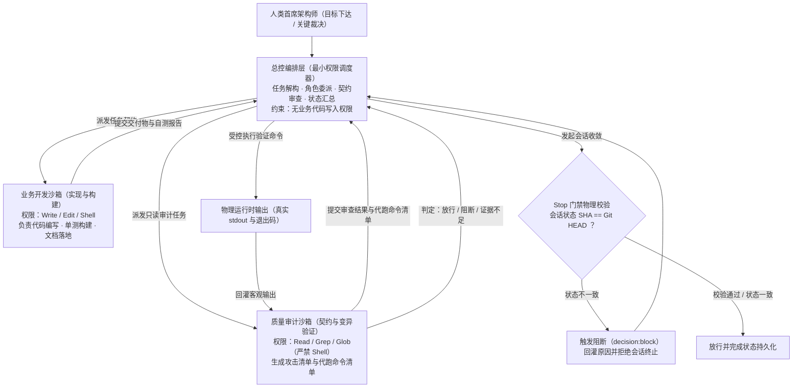

# AI 协同工程框架 (AI Collaboration Framework)

**中文** · [English](README.en.md)

[](./CLAUDE.md)
[](./GEMINI.md)
[](./LICENSE)
[](./examples/web3-koliance)
[](./packages/agent-guard)
[](./packages/agent-guard)

> **文档基线**：本框架以**中文为单一事实源（SSOT）**，英文文档（`README.en.md` / `AGENTS.en.md`）是语言投影；两者不一致时以中文为准（D4 规约）。
>
> **状态基准**：企业验证完成（Enterprise Proven）；包含 900+ 项通过用例的实战落地案例（`examples/web3-koliance/`）与标准化质量守卫工具包（`packages/agent-guard/`）。
> 本框架不仅是一套多 Agent 协作提示词，更是工业级**运行时契约测试、变异测试门禁、最小权限执行沙箱与上下文生命周期治理**的体系化工程实现。

---

## 一、它解决什么问题

在工业级软件工程中引入大语言模型（LLM）与自主代理（Agent）时，系统性崩溃往往并非源于模型智商不足，而是源于以下典型的**结构性失效**：

| 结构性失效形态 | 典型物理症状 | 框架治理机制 |
| --- | --- | --- |
| **推断代替实测** | 依据代码文件名或函数签名臆测运行时行为；将待办计划伪报为已完成成果 | **D1 运行时事实基准**：强制以物理命令 stdout 与文件只读断言为准，隔离构建与依赖干扰 |
| **阶段混流穿透** | 系统设计未评审即开始堆砌业务代码；测试未就绪即宣布具备交付标准 | **D2 阶段强阻断**：多阶段状态机硬门禁，前置准出物未达标立即阻断流程推进 |
| **虚假全绿与空分母** | 运行了 0 个测试却被误判为 100% 成功；只包含正向逻辑的断言在失败时静默漏检 | **D3 变异测试门禁**：强制要求负向故障注入用例与实质断言审计，拦截静默放行 |
| **事实漂移与双重认知** | 排障结论未回写系统设计文档；长程多轮交互中上下文膨胀导致记忆漂移 | **D4 单一事实源与上下文 GC**：原子化状态覆写、墓碑机制与自动修剪冗余回显 |
| **角色越界与权限穿透** | 单个 Agent 既充当架构师又充当开发者还兼任审计员；总控自行动手篡改代码 | **最小权限沙箱与职责隔离**：执行权、产出权与审计权物理隔离，审计沙箱剥离 Shell 权限 |

框架的底层工程立场：**上述结构性失效绝不能依赖 AI 的文字自觉，必须依托确定性代码门禁、沙箱隔离与可执行守卫。**

---

## 二、核心认知模型

复杂任务生命周期使用全局二维正交坐标系进行定位：

```text
纵向（系统层级）  规则 -> 组织 -> 业务 -> 系统 -> 代码 -> 运行 -> 数据 -> 经验
横向（生命周期）  立项 -> 需求 -> 设计 -> 开发 -> 测试 -> 发布 -> 部署 -> 运维 -> 故障 -> 迭代 -> 下线
```

总控 Agent 接收到用户指令时，必须在执行任何物理动作前完成两项断言：
「该任务落在生命周期的哪一阶段、系统架构的哪一层级？」
基于落格定位，严格匹配所需角色契约、输入边界与准出验收标准。

---

## 三、系统拓扑与控制流：最小权限执行沙箱与职责隔离

框架杜绝由单一 Agent 自行完成“开发-测试-放行”的全过程，采用**最小权限沙箱与三权职责隔离**的控制流：



### 职责隔离四大工程铁律

1. **执行权与产出权物理解耦**：总控 Agent 负责调度、分发、裁决与审查，严禁亲自下场修改业务代码；当专职角色缺失时立即阻断并请求介入，严禁静默降级为“总控自己写”。
2. **审计沙箱机械只读隔离**：审计角色（如 `qa-validator`, `gate-auditor`, `falsifier`）的可用工具集仅限 `Read`, `Grep`, `Glob`，**绝对禁止挂载任何 Shell 或代码写入工具**，杜绝利用 Shell 脚本落盘产生暗度陈仓的修改后门。
3. **命令代跑与客观回灌机制**：只读审计员无法直接运行命令，因此输出“攻击验证清单 + 待执行命令清单”；由总控在受控环境中代跑并捕获原始 stdout 与退出码，回灌给审计员进行客观事实判分。
4. **会话终止物理硬阻断**：在会话结束前，Stop Hook 自动比对项目状态台账中记录的 Git Commit SHA 与当前工作树真实的 `git rev-parse --short HEAD`。若存在未落盘的提交或状态脱节，直接触发 `decision:block` 拦截会话退出。

---

## 四、四大不可妥协工程纪律 (Zero Tolerance Disciplines)

### D1 · 运行时真实观测与事实基准 (Runtime Observability)
所有推论与决策必须依托**实际读取的物理文件内容**或**命令运行时的真实 stdout/stderr**，严禁凭经验或文件路径臆测。
文件扫描与统计口径**强制基于 `git ls-files`**，彻底隔离 `node_modules`、构建缓存与临时垃圾文件对统计分母的污染（在大型项目中，`find` 扫描容易引入数百个混淆文件导致覆盖率失真）。全链路时间戳统一采用 UTC ISO-8601 标准。

### D2 · 阶段转换强阻断 (Hard Stage Gates)
严格按生命周期时序单向推进。**前序阶段的准出验收资产未完备前，严禁生成后续阶段的实现代码**。
当门禁未通过时，必须输出明确的“阻断根因”与“解除条件”，严禁采用“先写业务代码、后面再补设计与测试”的妥协模式。

### D3 · 变异测试门禁与反静默放行 (Mutation Testing & Anti-Silent Pass)
所有自动化测试、看门狗脚本与监控探针，**必须具备对抗变异的实质断言能力**：
- 严禁空测试函数、仅包含 `pass` 或文档注释的伪测试；
- 严禁恒真断言（如 `assert True`, `expect(true).toBe(true)`）；
- 严禁空分母（0 个测试执行）被标记为 100% 成功；
- 凡涉及安全防护与质量门禁的脚本，必须通过负向故障注入用例验证：在人为植入故障时**必定触发阻断**，证明门禁具有实质防御力。

### D4 · 单一事实源与上下文生命周期治理 (SSOT & Context Lifecycle GC)
全局标识符采用严格命名规范：`ADR-`（架构决策）· `MIG-`（数据迁移）· `GAP-`（质量缺口）· `INC-`（事故复盘）· `DEFER-`（技术债务）。
任一环节产出结论（尤其是排障根因），必须立即原子化回写对应设计文档与台账，严禁两处不同成熟度的事实并存。在长程对话中，定期对巨型日志进行上下文剪枝（Context GC），提炼标准化状态断言，对废弃技术路径打上墓碑标记（Tombstone），彻底免疫模型幻觉与记忆漂移。

---

## 五、十环质量门禁矩阵 (Ten-Stage Gate Matrix)

在采用本框架的企业项目中，十环流水线均为**硬门禁**，前序环未满足准出标准时强行阻断：

| 环 | 门禁性质 | 准入与准出验收标准 | 验证工具 / 事实证据 |
| --- | --- | --- | --- |
| **01 设计** | 硬门禁 | ADR 架构决策落盘；数据 Schema 迁移具备单向时间戳；验收指标具备客观可测性 | 静态文档审计与契约规范核查 |
| **02 开发** | 硬门禁 | 代码实现严格遵循规范；提交前代码变更台账先写后填；禁止包含未清理的调试后门 | 静态类型检查与代码风格检查 |
| **03 测试** | 硬门禁 | 新增用例 100% 纳入 CI 矩阵；覆盖率达到配置阈值；测试套件通过实质断言审计（无假全绿） | `agent-guard check --stage test-audit` · CI 矩阵 |
| **04 构建** | 硬门禁 | 容器镜像采用不可变 Digest 锁定；运行时注入断言 `REVISION == Git HEAD` | 镜像签名与元数据清单 |
| **05 部署** | 硬门禁 | 部署脚本具备全链路幂等性（连续执行两次状态哈希一致）；配置项与环境变量双向对齐 | 幂等性沙箱演练报告 |
| **06 观测** | 硬门禁 | 告警系统分级完备；支持模拟服务宕机演练并能可靠触发告警 | 故障演练日志与告警记录 |
| **07 排障** | 硬门禁 | 建立秒级时间线事实链；完成对照组实验；排障根因原子化回写设计文档 | 排障复盘台账（RCA Markdown） |
| **08 恢复** | 硬门禁 | 灾备演练实测 RTO/RPO 达标；业务级最终一致性数据校验通过 | 灾备演练记录与数据一致性对账单 |
| **09 复盘** | 硬门禁 | 复盘改进项具备物理承载载体、依赖关系与量化可度量 DoD | 事故复盘台账与改进项追踪表 |
| **10 自动化** | 硬门禁 | 定时任务与自动化流程具备前置断言校验；执行产出独立归档报告 | 自动化巡检日志与定时器状态报告 |

---

## 六、标准化工具包：`agent-guard`

框架将工程门禁与上下文生命周期治理抽取为纯 Python 标准库工具包 `packages/agent-guard/`，无任何外部第三方依赖，兼容 Python 3.10+。

### 核心功能

1. **多阶段质量门禁扫描 (`gates.py`)**：
   - 验证工作区前置状态（无未合并冲突标记 `<<<<<<<`，基础规范文档齐全）；
   - 基于 AST 语法树（Python）与词法解析（TS/JS）深度扫描测试用例，精准捕获空测试体（`pass` / 仅文档注释）、恒真断言（`assert True`、`assert 1 == 1`、`expect(true).toBe(true)`）与零测试空分母，杜绝静默假全绿。
2. **上下文生命周期剪枝器 (`context_gc.py`)**：
   - 过滤命令输出中的进度条、加载动画与大段噪音，保留上下文核心关注点；
   - 自动提炼标准化状态断言（Canonical State Assertions），如 `[STATE_ASSERTION:test] unittest_status={"status": "PASSED", "tests": 20}`；
   - 单一事实源（SSOT）原子状态更新机制，杜绝记忆漂移；
   - 墓碑机制（Tombstone Registry），自动捕获并拦截已废弃技术路径的死灰复燃。
3. **企业级 CLI 入口 (`cli.py`)**：
   - `check`：一键扫描工作区门禁健康度与断言有效性；
   - `prune`：修剪巨型日志，提炼状态断言；
   - `init`：为项目初始化 `.agent-guard.json` 配置与 Git pre-commit hook 脚本。

### 安装与快速上手

```bash
# 本地可编辑模式安装
pip install -e packages/agent-guard

# 或直接通过 Python 模块调用
python3 -m agent_guard.cli --help
```

### CLI 命令用法

#### 1. 质量门禁检查 (`agent-guard check`)

```bash
# 扫描当前目录全部门禁（工作区前置条件 + 测试断言审计）
agent-guard check --path . --stage all

# 仅执行测试断言实质性审计，以 JSON 格式输出
agent-guard check --path . --stage test-audit --json
```

输出示例：
```text
=== agent-guard quality gate scan: /path/to/project ===
[PASS] Stage: PRE-ACTION | Code: PRE_ACTION_GATE_PASSED
       Message: Workspace preconditions satisfied: no merge conflicts and baseline files intact.
[PASS] Stage: TEST-AUDIT | Code: ASSERTION_AUDIT_PASSED
       Message: Audited 42 files with 932 tests and 1420 assertions. 0 critical issues found.
--------------------------------------------------
[RESULT] All quality gates PASSED.
```

#### 2. 上下文日志修剪 (`agent-guard prune`)

```bash
# 修剪巨型测试或编译日志，并检查是否违规引用墓碑标记
agent-guard prune --input test_run.log --tombstones "ads_power,legacy_auth"

# 仅提炼关键状态断言行
agent-guard prune --input test_run.log --extract-assertions
```

输出示例：
```text
[STATE_ASSERTION:process] command_exit_code=0
[STATE_ASSERTION:test] vitest_status={"status": "PASSED", "passed": 48}
[STATE_ASSERTION:vcs] git_working_tree="clean"
```

#### 3. 初始化项目配置与 Git 钩子 (`agent-guard init`)

```bash
# 生成 .agent-guard.json 并安装 Git pre-commit 钩子
agent-guard init --path . --install-hook
```

---

## 七、企业级落地与 900+ 自动化测试验证证据

本框架绝非纸上谈兵的理论模型，而是在大型商业级与极客级实战中淬炼而成：

### 1. 实战范例：`examples/web3-koliance/`
本仓库内置完整的 Web3 去中心化衍生品与量化交易平台落地项目（`examples/web3-koliance/`，向后兼容主路径为 `koliance/`）：
- **智能合约层**：EVM 永续合约、清算引擎与预言机喂价机制；
- **全栈应用层**：Next.js 14 App Router 客户端、高并发后端路由与会话鉴权系统；
- **撮合计算层**：Rust 撮合核心与性能基准跑分套件；
- **自动化测试集**：包含 40+ 独立测试模块、**900+ 项自动化测试用例全面通过**（涵盖 API 错误信封规范、跨地域延迟均衡、无伪造行情断言、多数据层一致性测试）。

运行实战案例测试集：
```bash
cd examples/web3-koliance
pnpm test
```

### 2. 工具包测试套件：`packages/agent-guard/tests/`
新抽取的 `agent-guard` 工具包自带 20 项全量自动化测试，覆盖 AST 语法审计、变异空断言拦截、上下文 GC、SSOT 覆写与 CLI 交互：

```bash
python3 -m unittest discover -s packages/agent-guard/tests -p 'test_*.py' -v
```

测试执行结果：
```text
Ran 20 tests in 0.014s
OK (100% Passed, Exit Code 0)
```

---

## 八、角色契约是三层（缺一不可）

框架中的角色契约严格分为三层，不可混淆：

| 层级 | 载体位置 | 契约职责与定义内容 | 审阅时机 |
| --- | --- | --- | --- |
| **第一层：模板** | [`prompts/角色契约.md`](prompts/角色契约.md) 第一部分 | 规范标准角色的 9 项核心要素：使命 / 责任范围 / 输入条件 / 工作流程 / 决策权限 / 输出契约 / 验收标准 / 升级条件 / 评价指标 | 框架常驻 |
| **第二层：注册表** | [`prompts/角色契约.md`](prompts/角色契约.md) 第二部分 | 登记系统中存在的合法角色池及各自输入/输出契约（禁止无证上岗） | 任务派发前必读 |
| **第三层：实现** | [`.claude/agents/`](.claude/agents/) | 项目已实例化的专职子代理配置：作用域 / 刚性边界 / 铁律 / 工具白名单（`tools`） | 随子代理运行时挂载 |

### 核心专职角色池（10 类）

- `biz-strategist` 商业闭环架构师
- `pm-spec-driver` 产品与需求定义师
- `system-architect` 分布式系统架构师
- `data-engineer` 存储与数据流工程师
- `backend-dev` 后端工程专家
- `qa-validator` 混沌工程与质量验证师
- `security-auditor` 安全合规与渗透审计师
- `sre-operator` 站点可靠性与运维工程师
- `postmortem-analyst` 事故与工程复盘专家
- `automation-builder` 流程自动化构建师

### 质量审计沙箱围栏

框架配备了只读审计角色实现：
- [`falsifier`](.claude/agents/falsifier.md) 变异与负向验证审计专员（只读）
- [`gate-auditor`](.claude/agents/gate-auditor.md) 阶段门禁准出审查专员（只读）

**工具权限围栏**：审计角色的配置中工具集仅允许 `Read`, `Grep`, `Glob`，绝对无任何终端 Shell 权限。

---

## 九、仓库文件地图

```text
ai-collaboration-framework/
├── README.md                           # 中文主文档（单一事实源 SSOT）
├── README.en.md                        # 英文投影文档
├── AGENTS.md                           # 跨运行时统一角色与门禁规约
├── CLAUDE.md                           # Claude Code 运行时入口
├── GEMINI.md                           # Antigravity 运行时入口
├── LICENSE                             # Apache 2.0 许可证
├── packages/
│   └── agent-guard/                    # 标准化门禁与上下文治理工具包
│       ├── agent_guard/
│       │   ├── __init__.py
│       │   ├── gates.py                # 多阶段质量门禁与 AST 断言审计
│       │   ├── context_gc.py           # 上下文生命周期剪枝与 SSOT 状态
│       │   └── cli.py                  # CLI 入口（check / prune / init）
│       ├── tests/
│       │   └── test_agent_guard.py     # 全量自动化单测（100% 绿灯）
│       ├── pyproject.toml              # 标准打包配置
│       └── setup.py                    # 兼容安装配置
├── examples/
│   ├── README.md                       # 案例集索引说明
│   └── web3-koliance -> ../koliance   # Web3 商业级实战落地范例（900+ 测试通过）
├── koliance/                           # Web3 全栈项目实体（合约、前端、后端、Rust 撮合）
├── .claude/
│   ├── agents/                         # Claude 运行时子代理定义
│   └── hooks/                          # 历史守卫钩子脚本
├── .agents/
│   └── hooks.json                      # Antigravity 运行时钩子挂载
└── prompts/
    ├── AI总控.md                       # 总控编排层系统提示词
    ├── 角色契约.md                     # 角色模板与官方注册表
    └── 全生命周期工程质量总监.md        # 十环流水线卡点标准
```

---

## 十、双运行时无侵入适配 (Claude Code · Antigravity)

框架原生支持双现代 Agent 运行时，做到 0 侵入双向兼容：

| 运行时环境 | 配置文件入口 | 挂载机制与隔离保障 |
| --- | --- | --- |
| **Claude Code CLI** | [`CLAUDE.md`](CLAUDE.md) | 自动加载 `.claude/agents/*.md` 子代理配置；只读角色通过配置 `tools: Read, Grep, Glob` 剥离 Shell 权限 |
| **Google Antigravity IDE** | [`GEMINI.md`](GEMINI.md) | 自动加载 `GEMINI.md` 与 `AGENTS.md`；通过 `.agents/hooks.json` 挂载运行时门禁；子代理通过 `define_subagent` 声明并限制写工具 |

---

## 十一、参与贡献与工程演进

### 质量验收准则
向本仓库提交任何 PR 必须满足以下门禁验收标准：
1. `agent-guard check --path . --stage all` 退出码为 0，且无任何空测试或恒真断言；
2. 新增 Python 模块符合 Python 3.10+ 标准库规范，不引入任何外部三方依赖；
3. 文档修改严格遵守中文为 SSOT 原则，同步更新 `README.md` 与 `README.en.md`；
4. 架构图仅使用 Mermaid 白名单语法（`flowchart TD`, `sequenceDiagram` 等），并对特殊字符转义。

---

## 十二、许可证

本项目采用 [Apache License 2.0](LICENSE) 开源许可证。
