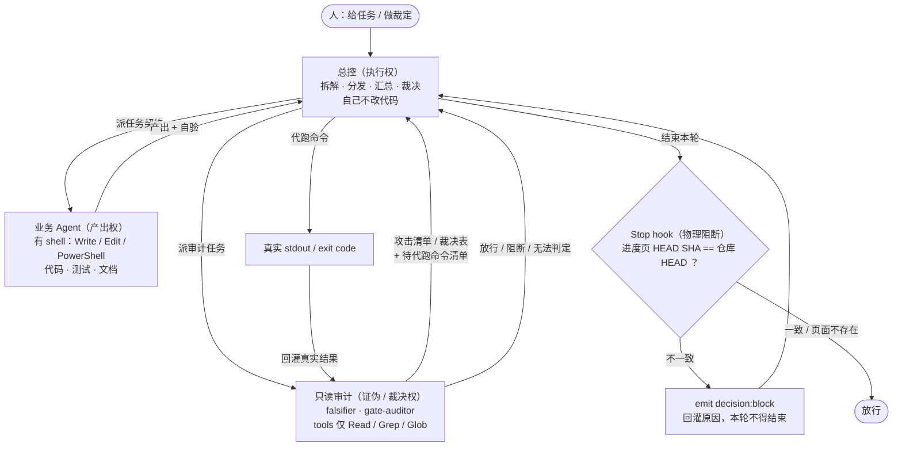
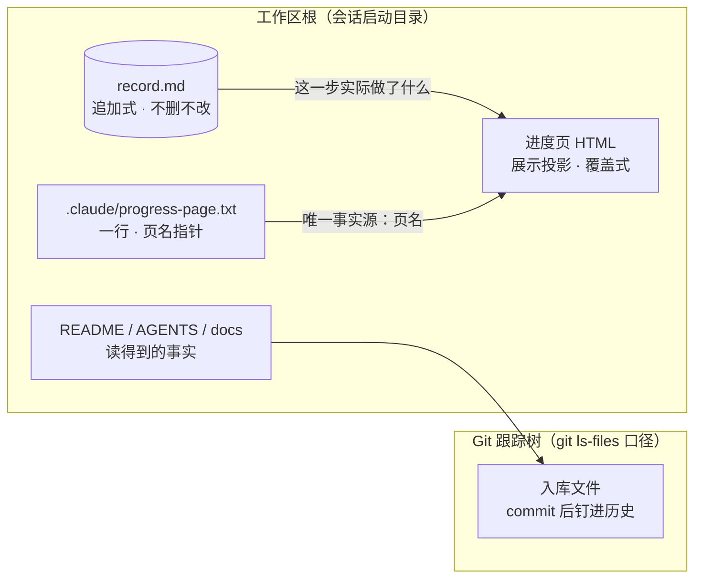

# AI 协同工程框架

**中文** · [English](README.en.md)

[](./CLAUDE.md)
[](./GEMINI.md)


> **文档基线**：本框架以**中文为单一事实源（SSOT）**，英文文档（`README.en.md` / `AGENTS.en.md`）
> 是**语言投影**；两者不一致时**以中文为准**（D4）。
>
> **状态如实标注**：**Experimental**；**首个版本标签 `v0.1.0`**（`2026-10-15` 打，见 Release）。
> 本仓是**模板**——它对 04/06–10 环无对应物属**模板性质**，**不构成"未通过"**；
> 但**仍受 D1–D4 四大纪律与机械守卫约束**（见 §五）。

> 一套给「人 + 多 AI 协同开发真实软件项目」用的**约束框架**。
> 它不教 AI 怎么写代码——它约束 AI **按什么次序、以什么证据、在什么边界内**产出，
> 并让每一次产出都留下**可复核的痕迹**。

本仓库不是模板脚手架，也不是 prompt 合集。它是一套**工程纪律的机制化**：
把「读到才算、转段阻断、判据可证伪、单一事实源」四条不可妥协纪律，
落成**门禁矩阵 + 角色契约 + 运行态契约 + 机械守卫**四件可执行的东西。

---

## 一、它解决什么问题

让 AI 干活，失败往往不是「模型不够聪明」，而是这几类**结构性失败**：

| 失败形态 | 典型症状 | 框架的对应机制 |
| --- | --- | --- |
| **推断代替实测** | 从组件名/文件名推测运行时行为；把"计划中的"当"已完成的"汇报 | 纪律 D1 |
| **阶段混流** | 设计没锁就写业务代码；测试门禁没有用例就宣布可发布 | 门禁矩阵 + D2 转段强阻断 |
| **虚假全绿** | 空分母被当成 100%；只看"成功路径"的判据**失败即静默** | D3 判据必须可证伪 |
| **两处不同成熟度的事实** | 排障结论没回写设计文档；进度页与仓库 HEAD 长期不一致 | D4 单一事实源 + 机械守卫 |
| **角色越界 / 静默降级** | 用通用子代理顶替缺失的专职角色；总控自己动手干活 | 角色契约三层 + 注册制 |

框架的立场是：**这些失败不能靠"提醒 AI 注意"解决，只能靠机制**。
所以框架里最重要的部分不是文字纪律，而是**能被证伪的判据**与**会阻断的钩子**。

---

## 二、核心认知模型

任务定位用一张二维坐标系：

```
纵向（系统层级）  规则 → 组织 → 业务 → 系统 → 代码 → 运行 → 数据 → 经验
横向（生命周期）  立项 → 需求 → 设计 → 开发 → 测试 → 发布 → 部署 → 运维 → 故障 → 迭代 → 下线
```

两者构成矩阵。总控 AI 接到任务时，先回答**两件事**：
「这落在哪一阶段、哪一层级？」——然后才决定召谁、给什么输入、要什么输出。

横向另有商业与工程约束：成本、供应链与协议、生态扩展、组织治理、风险、安全、可靠性、商业价值。

> 完整提示词见 [`prompts/AI总控.md`](prompts/AI总控.md)。

---

## 三、系统拓扑与控制流：三权分立

框架不靠「AI 自觉」，靠**权限互斥 + 一道物理闸门**：



**四个要点**：

| 要点 | 内容 |
| --- | --- |
| **执行权 ≠ 产出权** | 总控**自己不改代码**，改代码的一律是业务 Agent；角色缺失时**停下来**（禁止静默降级），而不是"总控自己干" |
| **只读是机械的** | 只读审计的 `tools` **不含任何 shell**——shell 本身是写后门（`Set-Content` 能落盘、能删文件），只挡 `Write` / `Edit` **挡不住它** |
| **代跑 → 回灌 → 据实判分** | 只读方**跑不了命令**，故产出**攻击清单 + 命令清单**；总控**代跑**后回灌**真实 stdout**，只读方**据实判分**。这是**显式分工，不是降级**；其缝隙（"代跑是否真的发生"目前无判据）已登记为 `GAP-005` |
| **物理阻断不靠模型自觉** | 会话结束前 Stop hook 比对**进度页记录的 HEAD SHA** 与 `git rev-parse --short HEAD`，不一致即 `decision:block`——**提醒会被忽略，阻断不会**（机制见 §九） |

**谁审谁有硬规则**：每完成一个生命周期阶段，必须依次派
`qa-validator` → `falsifier` → `gate-auditor`（**三跳链，缺一则不得推进**）；
**实现方自写自验 ≠ 03 环准出**。

> 📄 **规则原文在 `AGENTS.md`**：角色层与派发 **§4** · 三跳链 **§4.2** · 运行态与 Stop hook **§5**。
> 本节只是**拓扑投影**；与 `AGENTS.md` 冲突时**以 `AGENTS.md` 为准**。
>
> 仓库内的 `prompts/AI协同工程架构.png` 画的是**较早的扇出视角**（总控 → 并行 Agent 群 → 运行态产物），
> **没有**画出只读审计与物理阻断这两件东西。它**不是规则源**——读拓扑请看本节。

---

## 四、四大不可妥协纪律（Zero Tolerance）

### D1 · 读到才算，严禁推断
所有结论必须依托**实际读取的文件内容**或**命令真实 stdout**。
文件与统计口径**强制使用 `git ls-files`**——为的是隔离构建产物与依赖包。
（这不是洁癖：真实项目里实测 `find` 口径 **531** 个文件、`git ls-files` 口径 **252** 个，
**差 279 个**，全是构建产物与本地文件。用错口径，任何"覆盖率""文件数"结论都是假的。）
时间线一律断言 **UTC**。

### D2 · 转段强阻断（Hard Stage Gates）
严格按时序推进。**前一环准出未满足，禁止生成下一环的实现**。
被阻断时**输出阻断原因与解除条件**，而不是「先做着后面再补」。

### D3 · 判据必须可证伪（Falsification）
编写任何监控、定时任务、断言、门禁脚本，**必须同时提供负向验证用例**：
注入故障后**必定触发**告警/失败。
**对"失败即静默"的判据尤须警惕**——这类判据（如 hook、守卫脚本）
路径一旦写错，会**看起来一切正常却永远不拦**。
凡此类判据，验证必须跑负向用例；「一致时静默」**不足以**证明它有牙——
它区分不了「正常」与「死代码」。

### D4 · 单一事实源（SSOT）与标识符防漂移
标识符严格定义：`ADR-`（架构决策）· `MIG-`（数据库迁移）· `GAP-`（质量缺口）·
`INC-`（线上故障）· `DEFER-`（延期债务）。
任一环节产生结论（尤其排障根因），**必须立即回写**对应下游设计与产品文档。
**禁止两处不同成熟度的事实并存**。
冲突时：**仓库内文档 > 仓库外文档**；**代码与实测 > 文字描述**。
**登记新缺口前必须先检索全仓**——与既有编号撞车比漏登记更糟。

> 纪律原文（含十环流水线准入/准出卡点）见
> [`prompts/全生命周期工程质量总监与系统架构师.md`](prompts/全生命周期工程质量总监与系统架构师.md)。

---

## 五、门禁矩阵（Gate Matrix）

十环流水线，**全部为硬门禁**——任一环准出未满足即**阻断**下一环。
**对应物不存在时该环判「未满足」，不是「不适用」。**
本矩阵约束**采用本框架的项目**；**框架仓自身（本仓）是模板，不在此列**（本仓仍受 D1–D4 与机械守卫约束）。

| 环 | 性质 | 说明 |
| --- | --- | --- |
| **01 设计** | 🔒 硬门禁 | ADR 落盘 + Schema 迁移带时间戳 + 验收标准可测 |
| **02 开发** | 🔒 硬门禁 | 遵循 `docs/changes` **先写后填** + 统一命名规约 |
| **03 测试** | 🔒 硬门禁 | 新用例 100% 纳入 CI 矩阵 + 覆盖率**配置阈值** |
| **04 构建** | 🔒 硬门禁 | 镜像**不可变 Digest** + 运行时断言 `REVISION == Git HEAD` |
| **05 部署** | 🔒 硬门禁 | 脚本全链路幂等 + 配置与环境变量双向对齐 |
| **06 观测** | 🔒 硬门禁 | Alertmanager active 区分 + 严重度参与 + 真实停机演练 |
| **07 排障** | 🔒 硬门禁 | 秒级时间线 + 对照实验 + 根因回写 + 改进项转 GAP |
| **08 恢复** | 🔒 硬门禁 | 实测 RTO/RPO + 业务级可用性核验 |
| **09 复盘** | 🔒 硬门禁 | 行动项具备承载形式 / 依赖 / 可度量 DoD |
| **10 自动化** | 🔒 硬门禁 | 定时器前置条件断言 + 独立归档报告 |

> 完整矩阵见 [`AGENTS.md`](AGENTS.md) §2。

---

## 六、角色契约是三层（缺一不可）

这是本框架**最容易搞错**的一点：把「角色契约」等同于 `.claude/agents/*.md` 是错的——
那只是第三层。

| 层 | 文件 | 定义什么 | 何时读 |
| --- | --- | --- | --- |
| **模板** | [`prompts/角色契约.md`](prompts/角色契约.md) 第一部分 | 一个角色该写的 **9 项**：使命 / 责任范围 / 输入条件 / 工作流程 / 决策权限 / 输出契约 / 验收标准 / 升级条件 / 评价指标 | 常驻 |
| **注册表** | [`prompts/角色契约.md`](prompts/角色契约.md) 第二部分 | **有哪些角色** + 各自**输入契约 / 输出契约** | **派发前必读** |
| **实现** | [`.claude/agents/`](.claude/agents/) | 本项目**已实例化**的角色：作用域 / 硬边界 / 铁律 / `tools` 白名单 | 随子代理加载 |

> **模板与注册表合并在同一文件**，是本框架的一个取舍：二者是**同一份契约的两个视角**——
> 「一个角色该怎么写」与「有哪些角色这样写了」。分成两个文件时，改一个忘一个就会
> 产生**两处不同成熟度的定义**；合并后**结构上无法漂移**。

### 注册表登记的角色（10 类）

`biz-strategist` 商业闭环架构师 · `pm-spec-driver` 产品与需求定义师 ·
`system-architect` 分布式系统架构师 · `data-engineer` 存储与数据流工程师 ·
`backend-dev` Go/后端工程专家 · `qa-validator` 混沌工程与质量验证师 ·
`sre-operator` SRE 可观测性与稳定性专家 · `sec-auditor` 安全合规与权限审计师 ·
`finops-controller` 云成本与资源控制师 · `rca-investigator` 故障复盘与根因分析师

**这 10 类均已随框架提供实现**；另有 `contract-dev` / `frontend-dev` 两个**领域角色**，共 **12 类**
（见 [`.claude/agents/`](.claude/agents/)）。**每阶段收尾必须跨阶段派**（`qa-validator` → `falsifier` → `gate-auditor`），
见 `AGENTS.md` **§4.2 生命周期推进**。

**领域角色**（如 web3 项目的 `contract-dev`）**不在其列**——按项目领域**按需新建**
`.claude/agents/<角色名>.md`（跟踪见台账 `DEFER-006`），**不得**拿现有的顶替。
**未实例化的角色当前不可派发**。

### 本框架附带的实现（注册表中无对应名）

注册表登记的是**业务角色**。以下三个是**纪律的执行者**，不属那 10 类：

| 实现 | 服务哪条纪律 |
| --- | --- |
| [`ssot-scribe`](.claude/agents/ssot-scribe.md) 文档与台账维护 | D4 SSOT |
| [`gate-auditor`](.claude/agents/gate-auditor.md) 门禁审计（只读） | D2 转段强阻断 |
| [`falsifier`](.claude/agents/falsifier.md) 负向验证专责（只读） | D3 可证伪 |

业务角色的实现**按需新建**——只实例化你会派发的。需要时**新建** `.claude/agents/<注册表角色名>.md`，
**不得**拿现有的顶替。

> **「只读」是机械的，但判据不是「不含 Write/Edit」**：
> `falsifier` / `gate-auditor` 的 `tools` **仅 `Read` / `Grep` / `Glob`**——**不含任何 shell**。
> 原因是 **shell 本身是写后门**：`Set-Content` / `Out-File` / `Remove-Item` 都能落盘、能删文件，
> 只挡 `Write` / `Edit` **挡不住它**——那是**判据夹缝**（形态同 §十一「两道门只跑一道会漏」）。
> **代价是显式的**：只读角色**无法执行命令**，故其**执行由总控代跑**——
> 它们产出**攻击清单 / 裁决表 + 需代跑的命令清单**，总控回灌**真实 stdout** 后再据实判分。
> 详见 `AGENTS.md` §4 协同纪律。

### 子代理派发的硬约束

| 约束 | 内容 |
| --- | --- |
| **并发上限** | 单次任务召集的并发角色**不得超过 3 个** |
| **注册制** | **未在注册表登记的角色，禁止派发**（不派"模糊角色"） |
| **强制互审** | 架构/方案变更时**成对唤起**互审；交叉质询**上限 2 轮**，不收敛则**提炼分歧点上交人工** |
| **状态沉淀** | **子代理严禁擅自修改运行态记忆**——由总控提炼成 ≤5 行摘要后统一写入 |
| **禁止静默降级** | 角色不可用（未注册/缺角色）时**必须明确告知**，**不得**悄悄改成"总控自己干"或用通用子代理顶替 |
| **决策分派** | 遇决策点**不得停在原地等**，也**不得**默默做光——**非必要**（可逆 + 仓内 + **不构成豁免**）则**执行推荐**，**① 须在 `record.md` 留一行**并标明是推荐；**必要**则**记录后跳过**、继续下一个任务。**判据③ 的枚举是举例不是封闭集合**，且**凡效果是"少走一道本文件要求的检查"的推荐，一律走 ②**。**没有那个留痕，① 与"默默做光"在观测上同形** |
| **决策提醒义务** | **任务完成后**，总控**必须显式提醒**「有 N 项待你决策，见进度页 ① 组」——**给出计数与入口**，而不是让用户自己翻台账。**N 须等于台账 `待裁定` 表里「待人工裁定」的条数**（可核）；否则**记了但没被看见**，表现仍是"卡住不动" |
| **任务定位协议** | **动手前**：① **复述**（一句话，写给用户看）② **落格**（生命周期阶段 × 系统层级）③ **待确认**（复述错由用户当场纠正）。**明写「复述不是请求许可，是声明理解」**——除不可逆动作或用户明确要求外，**复述完即开工**，否则协议自己就成了「停在原地等」。判据 =「**被纠正过一次**」，可统计故可证伪（台账 `GAP-027`） |

> 最后两条是本框架里最容易被违反的。**「禁止静默降级」是有代价的**——
> 它意味着角色缺失时任务会**停下来**，而不是"先凑合做完"。
> 框架认为这个代价必须付：越出硬边界的产出**不采信**，**重派比返工便宜**。
>
> **「决策分派」是它的反面**——它管的是**该往前走的时候不要停**：
> 只列选项然后停下，正是"用户反复下同一道指令"的来源；而把该由人定的**不可逆**事项默默做掉，
> 则是反方向的错。两者根因相同：**没有一条"什么该停、什么该走"的分界线**。
> **边界在此**：**角色不可用 = 硬边界，必须停**；**日常决策 = 按可逆/仓内/不构成豁免三条判据分流**。
> 该规则**明文禁止**把「执行推荐」当成**门禁豁免**——D2 与 §2 门禁**要么满足、要么阻断，没有第三条路**。
>
> **「保留机械只读」也付了同族的代价**：只读角色因此**没有 shell**，
> 它们**跑不了命令**——其执行**一律交总控代跑**，产物是**攻击清单 / 裁决表 + 命令清单**。
> 这是**显式分工**，不是降级；但它引入了一条新缝隙，**已登记为 `GAP-005`**
> （见 [`docs/ledger.md`](docs/ledger.md)）：**「代跑是否真的发生」目前没有判据**——
> 代跑缺失时，产物会停在 `无法判定`，**与"确实没有 shell"外观相同**。

---

## 七、物理事实层：这一轮实际发生了什么的五个位置



| 位置 | 是什么 | 谁写 / 怎么变 | 入库 |
| --- | --- | --- | --- |
| **工作区根** | 会话启动目录，框架按它向上解析三条查找路径 | 由**启动位置**决定（启动器负责锁定） | — |
| **Git 跟踪树** | `git ls-files` 口径的入库文件——**测量口径强制用它**，隔离构建产物与依赖 | `git add` 显式文件路径后 commit | ✅ |
| **`record.md`** | 行为记录的**源**：命令级留痕，一行一条，**不删不改既有行** | 追加式 | ⬜ 运行态，挡在提交外（见 `.gitignore`） |
| **进度页（HTML）** | 给人看的**展示投影**：状态 / 用例数 / 覆盖率 / 台账 / 时间线 | **覆盖式**同步 | ⬜ 同上 |
| **`.claude/progress-page.txt`** | **一行**，给出进度页文件名——**页名的唯一事实源** | 改页名 = 改这一行 | ✅ |

**协同关系（一句话）**：`record.md` 答「**这一步实际做了什么**」，进度页答「**现在整体到哪了**」，
二者是**同一次记录的两个投影**，必须**同轮更新**——只更一个，另一个就成了**过时的事实**（D4）。
判据**不靠自觉**：Stop hook 读**指针文件给的名字**，比对页面里的 HEAD SHA 与仓库 HEAD（机制见 §九）。

> **为什么页名要走指针**：页面会随项目推进**改名**。把页名写死在脚本或文档里，
> 一次改名就让它**静默失效**——而"静默"正是它正常时的表现。

---

## 八、本仓库的文件地图

```
AGENTS.md                        唯一约束源。四大纪律 / 门禁矩阵 / 五段协议 / 角色层定义
AGENTS.en.md                     同上，英文版（同一规则源的语言投影）
CLAUDE.md                        Claude Code 瘦入口：@导入 AGENTS.md + 声明身份 + 启动自检
GEMINI.md                        Antigravity 瘦入口：@[label](path) 预加载 + 声明身份 + 启动自检
README.en.md                     README 英文版
LICENSE                          Apache-2.0
NOTICE                           版权与归属声明（Apache-2.0 §4(d)）

prompts/
  AI总控.md                      总控必备提示词（二维认知模型 8 层级 × 11 阶段）
  角色契约.md                     角色契约：模板（9 项）+ 注册表（12 角色）
  全生命周期工程质量总监与系统架构师.md   纪律原文（四大纪律 + 十环卡点）
  AI协同工程架构.png              拓扑图（**较早的扇出视角**；实时拓扑见 §三）

.claude/
  settings.json                  Claude Code Stop hook 配置
  hooks/check-progress.ps1       进度页滞后守卫（fail-closed，见 §九）
  hooks/check-numbers.ps1        编号跨分支撞车守卫（见 §九）
  hooks/self-test.ps1            **守卫与规则投影的一键自测（40 格）**——沙箱在临时目录、自删（见 §九）
  hooks/README.md                守卫实现细节（按需读）
  progress-page.txt              一行。进度页文件名的唯一事实源
  agents/*.md                    已实例化的角色（**12 类业务角色 + 3 类纪律执行者**）

.agents/
  hooks.json                     Antigravity 生命周期钩子配置（PreInvocation + Stop）
  hooks/inject-agents-tail.ps1   AGENTS.md 超 24KB 动态多片续载器（零侵入原文件，预留无限增长）
  hooks/stop-adapter.ps1         Stop 守卫协议转接器（零侵入复用 .claude/hooks/*.ps1）

launchers/
  start_claude.bat / start_claude.sh   启动器：锁定工作目录（见 §十）

docs/
  ledger.md                      未竟事项**唯一**台账（GAP/INC/DEFER）。**不在台账里的"还没做"等于不存在**
  planning/                      **计划锚**（`AGENTS.md` §0.2）：答「**去哪、为什么**」——多阶段路线图
    roadmap-production.md          **生产级演进路线图**：四阶段（状态源结构化 → 拦截点前移 → 语境按环路由 → 真实项目穿越）+ 自测扩容规划（按需读）
  ledger-evidence/               台账的**取证附录**（A–D：检索留痕 / 证据抄录 / 核验命令 / 守卫实测）
                                 **平时不读、按需打开**——台账正文只在需要复核时指向它
  reference-implementations.md   **十环参照实现**：每环准出在**真实生产仓**里长什么样（按需读）
  commit-guidelines.md           提交前规范：先 Issue 后 PR · 小步提交 · 门禁与核验清单（静态记忆文件，按需读）
  delivery-gates.md              交付路径细则：提交前本地门禁 · 待执行指令类文档（按需读）
  drift-cases.md                 框架落地时实测发现的漂移（**示例快照**，按需读）
  adopting.md                    **采用本框架**：逐环「语言插槽」对照表 · 最小初始化三步 · 项目化清单
  guard-self-test.md             **守卫自测的执行形态与读法**（一键入口 = `.claude/hooks/self-test.ps1`，按需读）
  known-issues.md                **架构成熟度评估与已知系统性问题分析**：四大问题域实测画像与收敛路径（按需读）
```

> ⚠️ **本图是位置约定、不是文件清单**——权威口径是 `git ls-files`（D1）；与实测不符时**以实测为准**。
> `AGENTS.md` §0.0 有一份**同源的简版树**（位置约定）；两处**同源**，
> 目前**无机械判据防止它们漂移**——该风险归入 `GAP-017` 的同族描述。

> **双语口径（一句）**：`README` 与 `AGENTS.md` 各有一份英文版，**中文版是基线**；
> 两者若不一致，**以中文版为准**（D4：不得让两处不同成熟度的事实并存——故此处明写谁为准）。
> 其余文档（`prompts/*`、`docs/ledger.md`）**暂只有中文**，属主动延期范围，见台账。

> ⚠️ **布局不唯一，本仓是「自托管」**：仓库 = **含 `.git`** 的那个目录（名字任意）。
> 上表按**目标布局**（仓库是工作区根下的子目录 `project/`）标注；
> **本仓的工作区根自身含 `.git`**，故**仓库即工作区根**，
> `docs/ledger.md` **就在仓库内**、属 ✅ **入库**的交付物。

---

## 九、运行态契约：记录是**两处投影**

框架要求**行为记录**与**给人看的进度页**同成熟度——这是 D4 的机械延伸：

| 处 | 角色 | 更新方式 |
| --- | --- | --- |
| `record.md` | 行为记录的**源**（命令级留痕，格式固定一行一条） | 追加式，**不删不改既有行** |
| **进度页**（HTML） | 给人看的**展示投影**（状态 / 用例数 / 覆盖率 / 缺口 / 时间线） | 覆盖式同步 |

**页名不固定**——它会随项目推进改名。故页名不写死在脚本或文档里，
而由 `.claude/progress-page.txt`（一行）指定：**改页名 = 改这一行**，
hook 与文档均无需改动。该文件是**页名的唯一事实源**。

**这条不靠自觉，靠机械保障**：`Stop` 钩子比对进度页里的 HEAD 标记与
`git rev-parse --short HEAD`，不一致就**阻断本轮结束**并把原因回灌给模型。

**四处刻意的设计**（都值得借鉴）：

1. **页面不存在时不检查**——页面尚未建立时守卫**静默放行**（`exit 0`，无输出）。
   判据的前提是「**页面存在且不得落后于仓库**」；页面不存在时**没有可滞后的事实**，
   **无判据可言**。**这是"尚未初始化"，不是"页面丢了"**。
2. **找不到 SHA 标记时静默**——页面被改结构到认不出时，报警不如不报（避免每次都误报）。
3. **不同步就阻断，而不是提醒**——「提醒会被忽略，阻断不会」。
4. **页名走指针文件**——写死则一次改名就让它**静默失效**。

> ⚠️ **这些分支使脚本"失败即无声"**：路径或页名推导一旦写错，它会**永远静默放行**。
> 故它**必须**用**两个分支**的负向用例来验证：
> ① **缺页** → 须**静默 `exit 0`**；② **注入错误 SHA**（页面存在）→ 须 emit `decision:block`。
> 只验「一致时静默」区分不了「正常」与「死代码」——
> 尤其**缺页分支与死代码在观测上等价**，只有 ② 仍有牙，才能反推 ① 的静默是"确无判据"。
> **改页名后务必重跑这两个用例。**

**首次使用工作区时初始化运行态**：`record.md` 与 `memory.md` 若**均不存在**，说明该工作区
**还没跑过**——**不是出错**。总控在首次会话中**直接创建**二者，**不请示、不上报**
（`memory.md` 由总控统一沉淀，子代理不得写）。

---

## 十、启用前提（这一步最容易错，且错了会静默失败）

Claude Code 的三条查找路径——`AGENTS.md` / `.claude/agents/` / `settings.json`——
**全部只向启动目录及其上层扫描，从不向下看**。

因此：

1. **必须从框架根目录启动**。若框架在一层子目录里而你把启动目录设在更上层，
   三条路径会**一起静默落空**——没有报错，只是框架像不存在。
2. **`.claude/` 需在会话启动时已存在**才会被加载。
   会话中途新增/移动 `.claude/`，**需打开一次 `/hooks` 重载，或重启会话**——
   当会话内不要指望它。
3. **启动器**：[`launchers/start_claude.bat`](launchers/start_claude.bat)（Windows）与
   [`launchers/start_claude.sh`](launchers/start_claude.sh)（Linux/macOS）各自先 `cd` 到工作区根
   （`cd /d "%~dp0.."` / `cd "$(dirname "$0")/.."`）来锁定工作目录。
   双击 `.bat` 时，CWD 取资源管理器位置而非脚本位置，
   所以「不加 `cd` 的启动器」会让启动位置**随双击位置漂移**。
   （这个坑真实踩过：框架静默失效，排查后发现启动器全文只有一行 `claude`，没有 `cd`。）
4. **排障**：用 `/context` 查看 **Memory files** 是否列出了 `AGENTS.md`。
   若只列出 `CLAUDE.md`，说明导入那行被破坏或路径写错。
   **另有一个已实测的坑**：`@path` 导入**遇中文目录名会静默失败**（中文**文件名**可以）。
   已实测：`prompts/AI总控.md`（ASCII 目录 + 中文文件名）导入**成功**；
   `中文目录/ascii.md` 导入**静默失败**。

> **框架就在仓库里**（**自托管布局**：仓库即工作区根）：框架与交付物**同在仓内**是**有意决定**，
> 不再靠"框架在仓外"。故运行态**改由随仓库分发的 `.gitignore`** 挡在提交之外。
> 曾经靠 `.gitignore` 挡过一次，**漏了**——被漏掉的是**叙述**（一份变更记录里
> "附：AI 协同框架"一节描述了框架本身），而不是文件。**忽略规则挡得住文件，挡不住叙述。**

### 双运行时自动调用与无侵入适配（Claude Code · Antigravity）

本框架支持 **Claude Code** 与 **Antigravity** 双端开箱即用。两套工具的底层机制不同，但通过 [`GEMINI.md`](GEMINI.md) 与 [`.agents/hooks.json`](.agents/hooks.json) 实现了**零侵入原有文件、100% 机械对齐**：

| 能力维度 | Claude Code 原生机制 | Antigravity 自动适配机制 |
| --- | --- | --- |
| **总控瘦入口** | `CLAUDE.md`（`@path` 展开导入） | `GEMINI.md`（`user_rules` 自动加载 + `@[label](path)` 工具层展开 `prompts/` 双文件） |
| **`AGENTS.md` 全量加载（突破 24KB 限制）** | `@AGENTS.md` 一次性全量展开 | 前 24KB 由 `user_rules` 自动加载；超出 24KB 的后半段由 `.agents/hooks.json` 的 **`PreInvocation`** 钩子（`inject-agents-tail.ps1`）从 23,000 字节处按 `≤24KB` **自动多片续载**（预留未来无限扩容，不改 `AGENTS.md` 原件） |
| **Stop 门禁守卫（进度页 + 编号撞车）** | `.claude/settings.json` 直接调用 `.claude/hooks/*.ps1`（`decision:block`） | `.agents/hooks.json` 的 **`Stop`** 钩子通过 `stop-adapter.ps1` **零侵入调用同一套 `.claude/hooks/*.ps1`**，将 `decision:block` 自动映射为 `decision:continue` 拦截回合结束 |
| **角色层与机械只读权限** | `.claude/agents/*.md` 自动挂载；只读角色 `tools: Read, Grep, Glob` | 调用 `define_subagent` 读取 `.claude/agents/<role>.md` 原文作为 `system_prompt`；只读角色（`falsifier` / `gate-auditor`）强制设 `enable_write_tools: false` 物理剥夺 shell 与写权限 |

---

## 十一、这套框架是怎么长出来的

框架不是设计出来的，是被真实项目**逼**出来的。
每一次调整、依据什么、否决了什么、以及**做错了什么**，都值得留档——
这一点见 [`AGENTS.md`](AGENTS.md) §8，那里把落地期间**实测抓到并修复**的漂移列成了靶子示例。

其中包括几次**代价真实的错误**，它们的价值高于任何"最佳实践"：

- 登记新缺口时**与既有编号撞车**，且撞车的是早已被审计报告覆盖的一项。
  教训被写进 D4：「撞车比漏登记更糟」。**登记前必须全仓检索。**
- 一个 fail-closed 的守卫脚本，**路径推导漏了一处回退**，导致旧布局下仍然静默失效。
  教训：fail-closed 判据的路径推导**必须每条都带回退**。
- 一份**看起来在保护某个财务公式**的对拍测试，实际**从不覆盖它**
  （源码里刻意把被测参数设为 0）。只跑一遍测试看到全绿的人**不会知道这里有洞**。
  推论：**"测试全绿"不等于"被测的东西被覆盖了"**。
- 「测试全绿」还有一个更隐蔽的形态：**两道独立的门，只跑一道会漏**——
  证伪时实测，只变异公式不重生成向量，另一侧**仍然绿**。
- 把框架**外发一次**之后才发现：框架内所有关于「框架在哪、去向何处」的**自指陈述**
  都要复验一遍。它们**不会被任何测试发现**——说的不是代码行为，是它自己所在的位置。
- `tools:` 名单里的工具名与**实际挂载名**不一致时，**被静默丢弃且不报错**。
  本框架的 `falsifier` 名单里写过 `Bash`，而本机挂载名是 **`PowerShell`** → 被丢弃 →
  该角色看起来"没有 shell 能力"，并据此**误诊**成"本环境不挂载 shell"，
  误诊还一度被**写进规则源**。教训：**声明的能力必须实测**——
  「**名字写错**」与「**能力缺失**」在观测上**不可分**，失败无声，故**不会被任何测试发现**。

这些记录**不被改写**。已发生的事实是证据链，不是待办事项。

---

## 十二、怎么用

1. **从工作区根启动**：
   - **Claude Code**：跑 `launchers/start_claude.bat`（Windows）或 `launchers/start_claude.sh`（Linux/macOS）——三条查找路径**只向上扫**，从别处启动框架会**静默不存在**（见 §十）。
   - **Antigravity**：直接用 Antigravity 打开工作区根目录（或从工作区根运行 `agy`）——系统会自动发现并加载 `GEMINI.md`、`AGENTS.md` 与 `.agents/hooks.json`。
2. **说你的事**：一句话交代任务即可。**总控**负责定位（生命周期 × 系统层级）、选角色、派活、汇总、裁决——**你不需要知道有哪些角色**。
3. **你做裁定**：架构变更、角色实例化、**外发/推送**这几类，总控会**停下来问你**；其余它自己推进。

运行态三件（`record.md` / `memory.md` / 进度页）由框架自动维护，**你不用管**；进度页是给人看的当前进展。

### 走查一：一次会话里的五道闸

> 场景：**新增一个用户查询接口**。下面每一步的闸门都是**规则里已有的**（出处已标），不是演示话术。
> ⚠️ **本框架仓是模板**——十环门禁约束的是**采用本框架的项目**。在本仓跑这个走查，你**看不到代码被拦**；
> 要观察真实拦截，去一个**采用本框架的项目仓**（见 §五）。

```
你：新增一个用户查询接口
  │
├─ ⓪ 动手前：任务定位协议 —— 复述 → 落格 → 待确认          （AGENTS.md §4.0）
│     └─ 总控先复述「你要我加一个用户查询接口」+ 落格「02 开发 × 代码层」
│        复述错 → 你当场纠正（不落格就动手，正是本框架要防的"反复下指令"）
│
  ├─ ① 总控试图直接进入 02 开发
  │     └─ ✗ 被「01 设计」硬门禁挡住 —— ADR 未落盘、验收标准不可测
  │        输出的是「阻断原因 + 解除条件」，不是"先写着，后面再补"        （AGENTS.md §2 / D2）
  │
  ├─ ② 补齐设计后开始编码
  │     └─ 派 backend-dev 写实现（写代码的是它，不是总控）
  │        产出要过「提交前本地门禁」的那一套 = CI 的那一套               （AGENTS.md §5）
  │
  ├─ ③ 阶段收尾：跨阶段三跳，缺一则不得推进                              （AGENTS.md §4.2）
  │     qa-validator  →  falsifier  →  gate-auditor
  │       qa-validator：独立于实现方的测试用例（实现方自写自验 ≠ 03 环准出）
  │       falsifier   ：只读、无 shell，产出「攻击清单 + 命令清单」
  │       总控代跑 → 回灌真实 stdout → falsifier 据实判分
  │
  └─ ④ 结束本轮前：Stop hook 物理校验
        ├─ 进度页 HEAD SHA ≠ 仓库 HEAD → emit decision:block，本轮不得结束 （AGENTS.md §5）
        └─ 一致 / 页面尚未建立        → 放行
```

**读者应已看出**：五道闸的**机械程度并不相同**——这一点必须说清，否则就成了夸大：

| 闸 | 靠什么生效 | 机械程度 |
| --- | --- | --- |
| ① 01 环门禁 | **规则**（D2）——靠总控**遵守** | ⚠️ **纯规则**：检查"上一环硬资产是否存在"的守卫**尚未建**（台账 `GAP-017`） |
| ② 提交前本地门禁 | **命令**——跑不过就不提交 | ✅ 机械（但**要靠人/CI 去跑**） |
| ③ 三跳链 | **角色契约 + 工具白名单** | ⚠️ **半机械**：「只读」是机械的（`tools` 不含 shell），但"**是否真的派了**"**没有守卫** |
| ④ Stop hook | **进程**——会话结束前真的会拦 | ✅ **纯机械**，唯一不依赖任何人自觉的一环 |

**这正是本框架的立场**：纪律不能靠提醒，只能靠机制（§一）——
**而机制有多少，就如实说多少**。上表里两个 ⚠️ 是**已知的、已登记的**缺口，
不是"以后再补"的托词；`GAP-017` 的解除条件就写在台账里。

### 走查二：亲手验证那道闸门有牙（D3 实操）

**为什么要你自己跑**：进度页守卫是**失败即静默**的判据——路径推导写错时它会**永远静默放行**，
而"静默"正是它正常时的表现。**"缺页时它没吭声"证明不了任何事**：那只说明
「确无判据」与「脚本已死」**在观测上不可分**（台账 `GAP-002`）。

**第一步：在你自己的工作树里先看一眼**（读数取决于你的工作树处于哪个分支）：

```powershell
powershell -NoProfile -ExecutionPolicy Bypass -File .claude/hooks/check-progress.ps1
```

| 你 | 看到什么 | 那属于哪个用例 |
| --- | --- | --- |
| **clone 本仓的读者** | **静默、无输出** | **用例①**——运行态（进度页）**不随仓库分发**，故命中缺页分支 |
| **维护者的工作树** | `{"decision":"block", …}` | **既不是①也不是②**——它只是**复读现状**（页面记的是旧 SHA），**没有注入任何东西** |

**第二步：两个用例必须一起跑**——但要在**隔离沙箱**里跑，那里 HEAD 是你自己造的、
页面是你自己写进去的，读数才可控。

**一键入口**（推荐，沙箱在系统临时目录、跑完自删、不碰你的工作树）：

```powershell
powershell -NoProfile -ExecutionPolicy Bypass -File .claude/hooks/self-test.ps1
# 期望：PASS = 40 / FAIL = 0，退出码 0
```

它覆盖 **A–F 六组共 40 格**：**A** 进度页守卫 13（含 `A12`/`A13`：比对**主干**而非当前 `HEAD`，`GAP-031`）·
**B** 编号守卫 2 · **C** 规则投影 16（`C1`×2 · `C2`×9 锚点 · `C3`–`C7`）·
**D** 双运行时对等 3 · **E** 进度页投影完整性 4 · **F** 角色只读围栏 2。**每一格的牙都做过负向验证**——
把守卫换成 `exit 0` 空壳、或对 C/D/E 逐格注入故障，**各自都会 FAIL**。

本文件下面只详述 **A 组的两格**；脚本与实测读数见
[`docs/guard-self-test.md`](docs/guard-self-test.md)：

- **用例①** 缺页 → 必须**静默 `exit 0`**（无任何输出）；
- **用例②** 页面**存在**且写错误 SHA → 必须 emit `{"decision":"block"}`。

> **只有 ② 仍有牙，才能反推 ① 的静默是"确无判据"，而不是"脚本死了"**（D3）——
> 这两个分支**在观测上等价**，单看 ① 永远分不出正常与死代码。
> **改页名后务必重跑**——页名由 `.claude/progress-page.txt` 指定，改名就是改那一行。
>
> ⚠️ **别用退出码判断它有没有牙**：block 路径是 **`exit 0` + stdout 的 JSON**
> （`exit 1` 留给「只提示不阻断」的两条通道）。判据要看**对的那条通道**（D1）。
>
> ⚠️ **为什么不把自测挂进 `Stop`**：实测约 21 s，而现有两钩子超时 15s/20s——
> 每轮再加 12 s 不划算，慢机器会顶到超时。**它是「改守卫 / 改规则后跑一次」的门禁**，
> 不是每轮守卫。**这是一个显式取舍（台账 `DEFER-014`），不是遗漏。**

### 采用它：门禁"语言插槽" + 最小初始化三步

**可插拔的关键一句**：十环门禁**约束的是状态机**（这一环有没有准出物、准出物是否可测），
**具体用什么命令去测是插槽里的东西**——框架**不绑定 Go、不绑定 TS、不绑定任何 CI**。

| 环 | 卡点（框架固定） | 插槽：判据（按栈填） |
| --- | --- | --- |
| **03 测试** | 新用例 100% 纳入 CI 矩阵 + 覆盖率**配置阈值** | **Go 栈** `go vet ./... && go test -race ./...` · **前端栈** `pnpm type:lint && pnpm test && pnpm build` |
| **05 部署** | 脚本全链路幂等 | 同一份部署脚本**连跑两次**，比对状态哈希 |

⚠️ **别把"我的栈没有这个对应物"读成"这一环不适用"**：对应物不存在时该环判
**「未满足」**（该建而未建），**不是「不适用」**。

**最小初始化（三步）**：① 复制 `launchers/` 与 `.claude/` 到工作区根 ·
② 配置 `.claude/progress-page.txt` 指针（一行）· ③ 在 `AGENTS.md` 里填项目专有内容。

> 📄 **逐环插槽对照表（01/03/04/05/10）· 三步的完整口径 · 采用前的项目化清单**：
> 见 [`docs/adopting.md`](docs/adopting.md)（**按需读**）。**规则权威源仍是 `AGENTS.md`**；
> 该文件与它冲突时以 `AGENTS.md` 为准（D4）。

---

## 十三、参与与路线图：架构成熟度、已知问题与深水区

**当前阶段**：机制已跑通（三权分立 + 双运行时零侵入适配 + Stop 物理阻断 + 负向用例齐备），**尚未发布版本**。
按本框架 D1（读到才算、拒绝粉饰）与 D4（单一事实源）自审，当前架构的**系统性局限与已知问题**归纳为四大维度（详细实测数据与收敛路径见 [`docs/known-issues.md`](docs/known-issues.md)，台账跟踪号 [`GAP-024`..`GAP-027`](docs/ledger.md)）：

| 已知问题维度 | 现状与核心症结（`git ls-files` 实测口径） | 台账跟踪 |
| --- | --- | --- |
| **1. 架构骨架更完整，但「物理咬合力」仍处于早期** | 全仓文本资产中 **87.1%**（38 个 `.md` · 5,374 行 · 602,469 B）为自然语言规则，仅 **12.4%**（5 个 `.ps1` + 2 个 `.json` · 1363 行 · 85509 B）具备进程级机械拦截（`2026-10-15` 实测；较 `2026-10-13` 的 `92.3% / 7.0%` 已有改善）。除回合前分片续载与回合末 `Stop` 守卫外，**十环转段准入、三跳链必派、总控不写业务代码、单次并发 ≤ 3 与五段输出协议仍靠模型自觉**，缺 `PreToolUse` / `pre-commit` 前置物理阻断 | [`GAP-024`](docs/ledger.md) · [`GAP-017`](docs/ledger.md) |
| **2. 代码载体依然具有强烈的「脚本胶水」属性** | 全部机械守卫承载于 **5 个 PowerShell 脚本（1,319 行）**，强耦合 Windows PowerShell 5.1（钩子写死 `powershell.exe`、大量代码为 PS 5.1 的 `stderr`/`EAP`/`$LASTEXITCODE`/`IsInputRedirected` 历史怪癖打补丁）；且进度页校验靠正则 `head\s*<b>...</b>` 抠取 HTML 字符串（UI 排版微调即落入「找不到标记静默放行」的失明分支），缺结构化元数据契约与跨平台一键自动化回归套件 | [`GAP-025`](docs/ledger.md) |
| **3. 多运行时适配放大了「机械一致性」的验证难度** | 双栈并行（Claude Code `@AGENTS.md` 单次展开 + 声明式 `tools:` vs Antigravity `24KB` 截断 + `PreInvocation` 动态分片 + `stop-adapter.ps1` 协议转接 + 命令式 `define_subagent(enable_write_tools: false)`）使验证矩阵翻倍；且 Antigravity 下只读角色的权限剥夺依赖总控调用时不漏传参数，缺 `PreToolUse` 前置强制与双端自动对拍工具 | [`GAP-026`](docs/ledger.md) · [`GAP-023`](docs/ledger.md) |
| **4. 已登记的深水区缺口与待裁定积压依然待解** | 触及「观测等价性」与「可信基边界」的深水区缺口（如只读代跑真伪无判据 `GAP-005`、缺页/unborn 静默与死代码同形 `GAP-002`/`GAP-012`、`GIT_DIR` 与同源互斥 shim 残余 `GAP-013①`/`GAP-019`）及 9 项延期/待人工价值裁定项（`DEFER-001/004/006/007..014`）仍待解 | 见下方深水区表与 [`docs/ledger.md`](docs/ledger.md) |

未竟事项**只有一处台账**——[`docs/ledger.md`](docs/ledger.md)：
**不在台账里的"还没做"等于不存在**。下面是从台账里挑出的**具体深水区条目**，
它们同时也是最欢迎外部讨论的地方：

| 编号 | 缺口一句话 | 为什么难 |
| --- | --- | --- |
| [`GAP-005`](docs/ledger.md) | 只读审计的执行改由**总控代跑**，但「**代跑是否真的发生**」**没有判据**——代跑缺失时产物停在 `无法判定`，**与"确实没有 shell"外观相同** | 需要把「代跑」**投影到留痕**上，且该痕迹要能被**机械核验**。目前只有一个最小锚（每次代跑追加一行），**不实时、且依赖总控自己写** |
| [`GAP-002`](docs/ledger.md) | 守卫**双静默**：指针一改错，「缺页静默」与「SHA 判据」**同时失效**；且「缺页静默」与「死代码」**在观测上等价** | **已缓解**（指针存在却读不出页名 → `exit 1` + stderr），**残余为已接受代价**：指针指向**不存在的页名**时仍静默 |
| [`GAP-017`](docs/ledger.md) | §4.2 生命周期推进给了**硬规则与三跳链**，但**没有任何守卫检查"上一环的硬资产是否存在"** | 于是"缺一则不得进入下一阶段"目前**只靠自觉**——与「提醒会被忽略，阻断不会」同族的缺陷 |
| [`GAP-018`](docs/ledger.md) | 有几处规则**依赖了某个具体项目的措辞**，换布局就**误伤或失义**（已改两处，其余须逐条排查） | 判据是「**依赖设计**，不依赖措辞」——但"哪几处还在依赖措辞"只能靠人读出来 |
| [`GAP-024`..`027`](docs/known-issues.md) | **物理咬合力早期（87.1% 纯规则）· PowerShell 脚本胶水与 HTML 正则脆弱性 · 双运行时机械一致性缺自动对拍 · 任务定位失败无承载形式** | 需将拦截点从回合末 `Stop` 前移至 `PreToolUse`/Git Hooks，将脚本胶水升级为跨平台结构化契约与自动化回归套件（详见 [`docs/known-issues.md`](docs/known-issues.md)） |

**怎么参与**（先读完 `AGENTS.md`，它才是规则源）：

- **认可这套哲学**——"纪律不能靠提醒，只能靠机制"——的话，最缺的是**适配脚本与前置守卫**：
  把十环的判据插槽（§十二）填成**你的技术栈**的可照抄命令，或为 `GAP-017`/`GAP-024`/`GAP-026` 贡献 `PreToolUse` 守卫，那正是本框架最想要的外部贡献。
- **发现判据有夹缝**：带**负向用例**来（注入什么故障能让它静默通过）——没有负向用例的
  "这里好像有问题"很难被采信，因为本框架的立场是 **D3：判据必须可证伪**。
- **发现文档与实测不符**：那属于 D4 范畴，**优先于功能**。本框架真实抓到过**幻影路径**——
  多份活跃文档指向一个并不存在的文件，**在有人实测之前，每个读到它的人都以为那是真的**。

> **参与前请先读**：[`AGENTS.md`](AGENTS.md)（规则源）· [`docs/ledger.md`](docs/ledger.md)（未竟事项唯一台账）· [`docs/known-issues.md`](docs/known-issues.md)（成熟度与已知问题分析）。
> **`README` 不是规则源**——它只是入口与投影；两者冲突时**以 `AGENTS.md` 为准**。

---

## 十四、许可与双语

本框架以 **Apache License 2.0** 开源（见 [`LICENSE`](LICENSE)，版权与归属另见 [`NOTICE`](NOTICE)）。

> ⚠️ **`2026-10-15` 由 MIT 升级为 Apache-2.0**（人工指令）。
> **相比 MIT，Apache-2.0 多两件东西**：① **显式的专利授权**（§3）——贡献者就其专利给你授权；
> ② **专利 retaliation 条款**——你若对贡献者发起专利诉讼，授权自动终止。
> 另有**商标**（§6，本许可不授予商标权）与**署名/NOTICE**（§4）要求。
> **代价**：条款更长、需随分发附 `LICENSE` 与 `NOTICE`。
> ⚠️ **与用户待办第 4 条的冲突（如实登记）**：`我要做什么.txt` 第 4 条原文写「且**使用MIT开源**」——
> **该条表述已落后于本次指令**。**不改动该源文件**（它是用户的），此处如实标注。

**语言**：`README` 与 `AGENTS.md` 各有中英两份。
**中文版是基线**；两者若不一致，**以中文版为准**——这是 D4（单一事实源）的落地：
两处并存时**必须明写谁为准**，否则就是两处不同成熟度的事实。

| 中文（基线） | English |
| --- | --- |
| [`README.md`](README.md) | [`README.en.md`](README.en.md) |
| [`AGENTS.md`](AGENTS.md) | [`AGENTS.en.md`](AGENTS.en.md) |

> 其余文档（`prompts/*`、`docs/ledger.md`）**暂只有中文**——属**主动延期**范围，见台账。
---

### 议题（Issues）与 Wiki

**议题**：<https://github.com/Yotoha0303/ai-collaboration-framework/issues>

**它是什么**：**台账的公开投影 + 未定稿讨论的入口**。
本仓库的未竟事项**唯一台账是 [`docs/ledger.md`](docs/ledger.md)**；议题**不复制台账正文**，
只放**编号 + 一句话 + 指向台账的指针**（D4：同一份事实不做两处副本）。

| 类别 | 去哪 |
| --- | --- |
| **已有编号的框架缺口**（`GAP-` / `DEFER-`） | 议题 = **台账的公开投影**，便于订阅与讨论 |
| **未定稿的想法**（**尚无编号**） | 议题 —— **讨论定稿后**才落 `GAP-`/`DEFER-` 编号 |
| **只能由人或平台做的**（建 wiki / 分支保护 / 平台密钥） | **不是议题** —— 见 `AGENTS.md` §5「待执行指令类文档」（「谁做」只有「人 / 平台」两种取值） |

**Wiki**：<https://github.com/Yotoha0303/ai-collaboration-framework/wiki>

**它是什么**：把「**怎么用**」写成人能读懂的顺序——**规则本身不在那里复述**。
**Wiki 不是规则源**，与仓库冲突时**一律以仓库为准**（D4）。

| 页 | 内容 |
| --- | --- |
| [Home](https://github.com/Yotoha0303/ai-collaboration-framework/wiki/Home) | 导航 · 三条最容易踩的坑 · 仓库各入口 |
| [简单入门](https://github.com/Yotoha0303/ai-collaboration-framework/wiki/Getting-Started) | 最小初始化三步 → 从工作区根启动 → 开始/接手项目 → **亲手验证那道闸有牙** → 两处投影 |
| [熟练操作](https://github.com/Yotoha0303/ai-collaboration-framework/wiki/Advanced-Usage) | **哪些有牙哪些没有** · 一键自测 · 三跳链 · 决策分派 · 小步提交 · 遇问题去哪查 |
| [生产项目参考](https://github.com/Yotoha0303/ai-collaboration-framework/wiki/Production-Examples) | 领到 [`docs/reference-implementations.md`](docs/reference-implementations.md)（两个真实生产仓的取材）与漂移案例 |