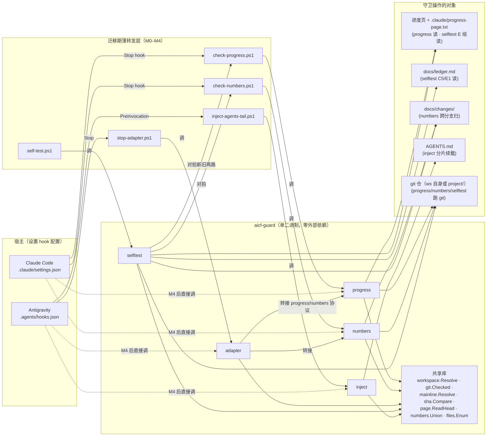

# ADR-001: 用 Go 单二进制 `aicf-guard` 收拢 5 个 PowerShell 守卫

- **状态**: **Accepted**（`2026-10-28` 总控 D1 复测 P0 五条收敛：R1 编号不写死 / R2 M3 基线锁定 / R3 分母=`.ps1`+新增 / R4 `--version` / R5 CWD 待实测 均落 ADR 且负向 grep 通过；M0 前 P1 R6/R10/R13 落定；M4 前 P1 R7/R8/R14 标「M4 前补」；P2 渐进。互审第 2 轮收敛，**未派 `sre-operator` 复审**（已收敛，§4.0 上限非下限）。**01 设计环准出，可进 02 开发 M0**）
- **日期**: 2026-10-28（UTC）
- **作者**: `system-architect`（01 设计环）
- **关联**: `GAP-025`②（脚本胶水，已缓解·残余）· `GAP-028`②（挂载层写死 `powershell`）· `GAP-029`（自测尺子布局无关性，已实现·待复核）· `GAP-031`（主干比对，已实现·待复核）· `DEFER-014`（自测是否挂 Stop）· issue #6 · 路线图 `docs/planning/roadmap-production.md` P1.2（`:63-68`）· 用户待办 #11
- **本仓定位**: 框架仓**第一个 ADR**（框架仓此前无 ADR——模板性质，`AGENTS.md` §2 豁免十环；本 ADR 是把该豁免**补上**的第一步）

---

## 1. 背景（Context）

### 1.1 触发事件（实测）

用户从 Windows 迁移到 Linux（`bash 5.3` · `go1.27.3` 已装 · **`pwsh`/`powershell` 未安装**）。
`.claude/settings.json` 与 `.agents/hooks.json` 的 hook 命令**写死** `powershell -NoProfile -ExecutionPolicy Bypass -File …`
（实测见 `.claude/settings.json` · `.agents/hooks.json`）⇒ Linux 上**全部失效**（`exit 127` · `command not found`）。
这是**已登记**的 `GAP-028`②（挂载层写死运行时）与 `GAP-025`②（脚本胶水）的实测爆发点。

### 1.2 待收拢的 5 个脚本（实测行数，D1）

| 脚本 | 行数 | 角色 | 退出码契约（必须 1:1 迁移） |
| --- | --- | --- | --- |
| `.claude/hooks/check-progress.ps1` | 413 | Claude Code Stop hook | `exit 0`+空 stdout=放行 · `exit 0`+`{"decision":"block","reason"}` JSON=阻断 · `exit 1`+stderr=非阻断提示（git 不可用 / 指针异常） · 多个**刻意静默**分支（缺页 / unborn / 无主干） |
| `.claude/hooks/check-numbers.ps1` | 280 | Claude Code Stop hook | `exit 0`+空=无撞车 · `exit 1`+stderr=撞车**或**守卫跑不起来（**notice 不阻断**，因撞车分支可能不可由本会话改写） |
| `.claude/hooks/self-test.ps1` | 1576 | 自测尺子（D3） | `exit 0`=全部格子符合预期 · `exit 1`=至少一格不符（守卫可能已瞎）· 含 A–G 七组、`SELFTEST_INJECT` 注入开关、沙箱自铺自清 |
| `.agents/hooks/inject-agents-tail.ps1` | 103 | Antigravity PreInvocation | `exit 0`+`{}`=无需续载 · `exit 0`+`{"injectSteps":[{"ephemeralMessage":…}]}`=分片续载 AGENTS.md（绕 24KB 截断） |
| `.agents/hooks/stop-adapter.ps1` | 80 | Antigravity Stop 适配 | `exit 0`+`{"decision":"allow"}`=放行 · `exit 0`+`{"decision":"continue","reason":…}`=转接 Claude Code 的 block/notice 为 Antigravity 协议 |
| **合计** | **2,452** | | |

> ⚠️ 路线图 `roadmap-production.md:41` 称「5 个脚本 1,210 行」——**该数字已过期**（`2026-10-28` 实测为 **2,452 行**，`self-test.ps1` 从方案采集时的体量已增至 1,576 行）。本 ADR 一律以实测为准（D1）。**此差异属路线图自身的数字漂移，归 `GAP-025` 同族，不在本 ADR 作用域内修正**——本 ADR 只如实记当前实测。

### 1.3 既有判据契约（**不得破坏**，`AGENTS.md` §5）

两条 Stop 守卫的协议是**已发布契约**，下游 hook 配置与 `self-test.ps1` 的 D3 格都依赖它。重写**必须逐字保留**以下不变量（来源：各脚本注释 + `docs/ledger.md` 的 GAP 留痕）：

1. **「THE ONE RULE」**（`check-progress.ps1:29-42`）：每个 git 调用的**判据是退出码**，输出只是载荷。**不得**用输出版本性判真伪。
2. **负向金丝雀**（`check-progress.ps1:265-269` · `check-numbers.ps1:136-139`）：`git rev-parse --verify --quiet 0000…^{commit}` **必须失败**（exit≠0）；对必定失败的输入仍返回 0 ⇒ 判「git 退出码不可信」⇒ 走 notice 分支，**不得**静默。
3. **`GIT_*` 环境变量族清空**（`check-progress.ps1:128-138` · 9 个变量）：每次 git 调用前清空整族、调用后还原。**族成员不可缩减**（`GAP-013①` + `GAP-031` 实测：只清 `GIT_DIR` 不够，`GIT_OBJECT_DIRECTORY`/`GIT_COMMON_DIR` 会劫持 `rev-parse --verify <ref>^{commit}`）。
4. **主干三级回退**（`GAP-031`）：`refs/remotes/origin/HEAD`（须再过 `rev-parse --verify`）→ `refs/heads/main` → `HEAD`（显式兜底）。`reason` **必须点名**实际比的那条线。
5. **SHA 双侧归一为 full id 再比**（`GAP-008`）：两侧各 `rev-parse --verify` 归一到 40 位 lowercase hex 再比，**不得**用前缀比对。
6. **HTML 正则**（`check-progress.ps1:375`）：`<div[^>]*>\s*head\s*<b[^>]*>\s*([0-9a-fA-F]{7,40})\s*</b[^>]*>\s*</div[^>]*>`。**残余**（`GAP-025`）：重构成 `<span>` 仍静默——**本 ADR 不修此项**（保留同款正则与同款静默行为；真修在 P1.1 的 `state.json`，见 §6）。
7. **编号撞车判据**（`check-numbers.ps1`）：跨分支并集 + 本地/远端同叶折叠（`refs/heads/X` 与 `refs/remotes/origin/X` 视为同支）+ `(path, oid)` 二元组去重 + `HashSet` Ordinal（大小写敏感）。
8. **`stop-adapter` 协议转接**：`{"decision":"block"}`→`{"decision":"continue"}` · `exit 1`+stderr→透传 stderr 且 `continue` · `exit 0`+空→`allow`。
9. **selftest 的 G1/G2 注入**（`self-test.ps1:372-389`）：`SELFTEST_INJECT=noenum` ⇒ 枚举恒空 ⇒ C3/C5/C6/C7 必须 FAIL；`SELFTEST_INJECT=norepo` ⇒ 报错 + exit 1。**这是「修好了」自身的负向证伪**，Go 版必须保留同款开关与同款期望。

### 1.4 D1 张力点（`GAP-029`，必须在 ADR 显式处理）

`AGENTS.md` D1 强制文件枚举用 `git ls-files`。但**目标布局 / 带项目布局**下（`AGENTS.md` §0.0），**框架文件不在任何仓里** ⇒ `git ls-files` 枚举不到它们 ⇒ selftest 的 C 组**结构性塌成零输入而「绿」**（`GAP-029` 实测：C3 从 108 张表变 0 张表仍 PASS）。

**本 ADR 的处置**：
- **守卫子命令**（`progress`/`numbers`/`adapter`）操作的是**业务/框架仓本身**，仓就在那里，**D1 的 `git ls-files` 口径正常适用**——不改。
- **`selftest` 子命令**的文件枚举**必须布局无关**：当工作区根自身是仓（自托管）走 `git ls-files`（读数与现状逐字节一致）；否则走**文件系统遍历**（跳过含 `.git` 的子目录 = 业务仓根、跳过 `node_modules`/`.next`、显式栈防符号链接成环、物理目标去重、须落在工作区根之内）。
- **这是 D1 的有界例外，不是违背**：D1 的精神是「隔离构建产物与依赖包」，`git ls-files` 是手段；当手段**结构性失效**（框架文件不在仓里）时，沿用手段等于**零输入假绿**——那正是 D1 要防的反面。例外**仅限 selftest 的框架文件枚举**，且**必须带「输入非空」前提**（C3/C5/C7 的谓词已含 `$count -gt 0`），否则「零输入」与「扫过了」不可分（D3）。

---

## 2. 决策（Decision）

用**零外部依赖的 Go 单二进制 `aicf-guard`** 收拢 5 个 `.ps1`，子命令同名，原 `.ps1` 迁移期留**薄转发层**，渐进迁移（一个子命令一个 PR）。

### 2.1 子命令结构

```
aicf-guard progress   # ← check-progress.ps1
aicf-guard numbers    # ← check-numbers.ps1
aicf-guard inject     # ← inject-agents-tail.ps1
aicf-guard adapter    # ← stop-adapter.ps1
aicf-guard selftest   # ← self-test.ps1
aicf-guard --version  # ← 新增（04 环 REVISION 断言对齐，见下）
```

**`aicf-guard --version`**（无对应 `.ps1`，纯新增）：输出 `aicf-guard <semver> (<commit-hash>)` 一行到 stdout，exit 0。`<semver>` 来自构建期注入（`-ldflags "-X main.version=v0.1.0"`，tag `aicf-guard-v<semver>` 触发 Release 时由 CI 注入，见 §6.7）；`<commit-hash>` 同样构建期注入（`git rev-parse --short HEAD`）。**用途**：① 对齐 `AGENTS.md` §2 的 04 环准出「运行时断言 `REVISION == Git HEAD`」——selftest 首格断言 `--version` 输出的 commit 与 `git rev-parse HEAD` 一致（构建产物与源树不漂移）；② 采用方接入时确认下载的 Release 产物版本；③ `doctor`（M4 后自检，R7）以此为入口校验二进制完整性。**`--version` 不读工作区、不调 git、不依赖任何外部状态**——纯返回构建期常量，确保任何 CWD/环境都能拿到稳定输出。

共享入口 `aicf-guard <subcommand> [flags]`；`--workspace <path>` 显式覆盖工作区根（供 selftest 沙箱与单测）；`-h`/`--help` 每级都有。**除 `--version` 外不发明新子命令名**——同名是迁移期可对照的前提（每个子命令一个 PR 时，新旧可同沙箱对拍）。

### 2.2 共享库（抽取的共用逻辑，**不写代码**——交 `backend-dev`）

| 共享件 | 来源 | 说明 |
| --- | --- | --- |
| `workspace.Resolve()` | `check-progress.ps1:185-291` · `self-test.ps1:154-160` | 工作区根 + 仓库根候选解析。**分层解析**（优先级，见 §2.3）：① `--workspace` 旗标 · ② `CLAUDE_PROJECT_DIR` 环境变量 · ③ `os.Executable()` 路径回推（保留 .ps1「自定位」健壮性）· ④ CWD 向上找 `.claude/`/`.agents/`。仓库候选 `@[ws, ws/project]`、**ws 优先**、须 `git rev-parse --git-dir` exit 0 才算数（`GAP-009`） |
| `git.Checked()` | `check-progress.ps1:139-181` · `check-numbers.ps1:39-77` | 唯一的 git 入口。清 `GIT_*` 整族（9 个）→ 跑 → 读 exit code → 还原。返回 `{Exit, Text}`。**判据恒为 `.Exit`**，`.Text` 是载荷。**全仓仅此一处读 git exit code**（D4：同一判据不做两处实现） |
| `git.Probe()` + `git.Canary()` | `check-progress.ps1:246-269` | 正向探针 `git --version`（须 exit 0）+ 负向金丝雀 `git rev-parse --verify 0000…^{commit}`（须 exit≠0）。两者**同款**，强制 git 对两个不同输入返回不同 exit code |
| `mainline.Resolve()` | `check-progress.ps1:314-348` · `self-test.ps1:169-187` | `GAP-031` 三级回退。返回 `{Ref, Name}`；`Name` 用于 reason 点名。**与 selftest 同款**（D4：尺子与守卫同一口径，否则特性分支上 E3/E4 假红） |
| `sha.Compare()` | `check-progress.ps1:345-397` | 两侧各 `rev-parse --verify` 归一 full id（lowercase hex）再比。`GAP-008` 不动 |
| `page.ReadHead()` | `check-progress.ps1:352-378` | 读进度页 + 正则抠 SHA。**保留同款正则与同款静默**（`GAP-025` 残余不在此修） |
| `numbers.UnionBranches()` | `check-numbers.ps1:141-250` | 跨分支并集 + 同叶折叠 + `(path, oid)` Ordinal HashSet |
| `files.Enum()` | `self-test.ps1:284-352` | **布局无关**枚举（§1.4）。自托管走 `git ls-files`；否则文件系统遍历。**仅 selftest 用**；守卫不经过此路径 |

### 2.3 工作区根解析（关键设计点，sre-operator 互审重点）

`.ps1` 脚本**仅**靠「自定位」（`Split-Path $PSCommandPath`）找 ws，刻意不依赖 `CLAUDE_PROJECT_DIR`（`check-progress.ps1:44-49` 实测理由：hook 可能以任意 CWD 调用）。单二进制后，**自定位仍是优先项之一**，但不再是唯一项——因为二进制可能在 PATH 上（`os.Executable()` 指向 `/usr/local/bin`，无法回推 ws）。

**分层解析（优先级从严到宽）**：
1. `--workspace <path>`（显式；selftest 沙箱与单测必经此路）。
2. `CLAUDE_PROJECT_DIR`（Claude Code 必设；Antigravity 不设）。
3. `os.Executable()` 回推：若二进制在 `<ws>/.claude/hooks/` 或 `<ws>/.agents/hooks/` 或 `<ws>/bin/` 下，向上走到含 `.claude/` 或 `.agents/` 的目录。**保留 .ps1 的自定位健壮性**。
4. CWD 向上找 `.claude/` 或 `.agents/`（兜底）。

> ⚠️ **Antigravity 侧**：`.agents/hooks.json` 现用相对路径 `./hooks/…`。**R5（P0，D1）**：本 ADR 此前写「CWD=`.agents/`」是**从 `.agents/hooks.json` 的 `./hooks/…` 推断的，未实测**——不得作为设计前提。**修订**：Antigravity hook 的 CWD **待 M0 开工前实测**：在 `.agents/hooks/` 加探针 hook（写一行 `pwd` 到临时文件即可）由 Antigravity 实际触发，捕获真实 CWD。**若实测与 `.agents/` 假设不符**：改用**环境变量**传递 ws 路径（候选：① 自定义 `AICF_WORKSPACE` 显式设；② 复用 `CLAUDE_PROJECT_DIR`——但 Antigravity 不保证设此变量，须同次实测确认），**不依赖相对路径**——相对路径只在 CWD 已知且稳定时可靠，而 hook 的 CWD 是宿主契约、不由本仓控制。**探针实测结果记入 `docs/changes/00N` M0 记录**（D1：读到才算）。在实测落定前，§2.3 第 4 项「CWD 向上找 `.claude/`/`.agents/`」**仅作兜底**，不作主路径。
>
> **二进制位置推荐**（与 CWD 实测独立，可先定）：二进制置于 `<ws>/.claude/hooks/aicf-guard`，Antigravity 侧命令写 `../.claude/hooks/aicf-guard inject`（`.agents/` 与 `.claude/` 是兄弟，**前提是 CWD 实测确认是 `.agents/`**）；**或**保留 `.agents/hooks/` 下薄转发层（迁移期），由转发层调二进制——**与 `.ps1` 转发层同构**，降低跨运行时耦合。**此选择交 sre-operator 互审定**（见 §5 待审点 T1）。

### 2.4 跨平台构建

- **Go module**，`go.mod` 置于 `<ws>/aicf-guard/`（新建子目录，源码入库）；**仅用 Go 标准库**（`os`·`os/exec`·`path/filepath`·`regexp`·`encoding/json`·`strings`·`strconv`），**零外部依赖**（满足路线图「零外部依赖单二进制」）。
- **R13（P1，M0 前定）· `go.mod` 最低 Go 版本**：`go.mod` 首行 `go <version>` 锁定本 ADR 兼容的最低版本。**本仓实测**：`go1.27.3`（`AGENTS.md` §0.0 / 任务背景）。**采用方兼容性**：`aicf-guard` 用到的特性均为标准库长稳定 API（`os`·`os/exec`·`path/filepath`·`regexp`·`encoding/json`，无 generics、无 `slices`/`maps` 包依赖），**建议 `go 1.21`** 起（Go 1.21 是 [Go 官方支持策略](https://go.dev/doc/devel/release) 当下的下限附近，主流发行版包管理器均覆盖）。**M0 开工时由 `backend-dev` 实测**：用 `go1.21` 工具链能否编过；若用到的 API 需更高版本，按实测抬高至 `1.22`/`1.23`，**不臆测**。`<version>` 锁定后写入 `docs/changes/00N` M0 记录（D1）。**`aicf-guard/` 的 `go.mod` 与 `.claude/` 或顶层无关——独立 module、独立版本声明**。
- **构建目标**：`linux/amd64` · `linux/arm64` · `darwin/amd64` · `darwin/arm64` · `windows/amd64`。`CGO_ENABLED=0`（静态二进制，跨发行版可移植）。
- **产物命名**：`aicf-guard`（unix）/ `aicf-guard.exe`（windows）。
- **产物位置**：构建到 `<ws>/.claude/hooks/aicf-guard`（与原 `.ps1` 同目录，hook 配置改写最小）。**二进制不入库**（`.gitignore` 排除；与 `record.md`/`memory.md` 同属运行态/构建产物口径）。
- **分发**（sre-operator 互审重点 T2）：本仓（自托管）用户本地 `go build`（go1.27.3 已装）；**采用方**两种路径——① 装了 Go ⇒ `go build`；② 未装 Go ⇒ 从 GitHub Release 下载预编译二进制（`ONBOARDING.md` 增一步「download or build」）。**Release 流程交 sre-operator 定**。

### 2.5 退出码与协议对齐（验收的硬判据）

每个子命令的 exit code / stdout / stderr **逐字对齐** §1.2 的契约表。**迁移期对拍**：每个子命令一个 PR，PR 内跑「同沙箱、同输入、新旧两路 exit code 与 stdout 逐字节比对」的对拍测试（`self-test.ps1` 的 `Invoke-Guard` 即此模式的现成形态）。**对拍不等价 = 该 PR 阻断**。

---

## 3. 迁移策略（一个子命令一个 PR，渐进）

| 阶段 | 动作 | 准出 |
| --- | --- | --- |
| **M0** | 建 `aicf-guard/` Go module 骨架 + 共享库 + `progress` 子命令；`.claude/hooks/check-progress.ps1` 改为薄转发层（调 `aicf-guard progress`，**二进制缺失 ⇒ 走 notice 分支 `exit 1`+stderr，不得静默**） | 同沙箱对拍逐字节一致；selftest A 组全 PASS（含新增「二进制缺失」格，§6.6）；`.gitignore` 排除规则就位（§6.8 R10）；`--version` 子命令就位（§2.1 R4） |
| **M1** | `numbers` 子命令 + 转发层 | B 组 PASS |
| **M2** | `inject` + `adapter` 子命令 + `.agents/hooks/` 转发层 | D3 格（退出码 ⊆ adapter 覆盖）仍 PASS |
| **M3** | `selftest` 子命令（最复杂，含沙箱自铺/自清/G1-G2 注入） | C/E/F 组全 PASS；**耗时 < 1s**（`DEFER-014` 解除）；**M3 基线锁定见 §6.3 R2** |
| **M4** | **切换 hook 配置**：`.claude/settings.json` 与 `.agents/hooks.json` 改为直接调 `aicf-guard <subcommand>`（**去掉 `powershell`**）⇒ Linux 守卫恢复 | Linux 上 `aicf-guard selftest` 全 PASS；**M4 前 P1（R7 `doctor` / R8 端到端准出 / R14 ONBOARDING sha256）必补（§8.2）** |
| **M5**（可选） | 删除 `.ps1` 转发层（直接调用已验证） | 仓库 `.ps1` 仅留历史；`C7` 格口径随 `.ps1` 消失而调整 |

> ⚠️ **M4 是用户痛点的解除点**：M0–M3 在 Windows 上验证逻辑等价，但 Linux 上 hook 仍失效（因 settings.json 还写 `powershell`）。**M4 一刀切后 Linux 守卫才真正恢复**。若用户急需，可把 M4 的「settings.json 切换」**单独前置**（仅切 `progress`/`numbers` 两条 Stop hook，`inject`/`adapter` 留后），**不等 M2/M3**——但须先有 M0/M1 的 Go 实现与对拍。**此前置与否交总控与用户裁定**（属可逆的仓内改动，但改变 hook 契约的运行时，建议先过 sre-operator 互审）。

### 薄转发层契约（迁移期 SPOF 缓解）

`.ps1` 转发层**不是**纯透传——它必须在**二进制缺失**时仍守 fail-closed：
- `check-progress.ps1` 转发层：二进制缺失 ⇒ 按原「git 不可用」分支处置（`exit 1` + stderr 提示），**不得** `exit 0` 静默（否则 = 守卫被悄悄关掉）。
- `check-numbers.ps1` 转发层：二进制缺失 ⇒ `exit 1` + stderr（notice，同原「守卫跑不起来」分支）。
- `inject`/`adapter` 转发层：二进制缺失 ⇒ 输出 `{}` / `{"decision":"allow"}` + `exit 0`（**与原 catch 分支同款**——Antigravity 侧 fail-safe 不 bricked session）。

**判据**：selftest 增一格「二进制缺失 ⇒ 各转发层走对应 fail 分支」（M0 即建）。

---

## 4. 替代方案（Options）与权衡（Trade-offs）

### Option A —— Go 单二进制（**本 ADR 推荐**，路线图既定）

- **优点**：① 零运行时依赖（静态二进制，Linux/Win/macOS 通用）；② 自测 `<1s`（Go 子进程启动 ~5ms vs powershell.exe ~500ms，40 格 × 500ms ≈ 20s → ~200ms，`DEFER-014` 解除）；③ 类型安全、可单测、可对拍；④ 一个产物管五职能，共享库消除 D4 重复实现；⑤ 铲除 PS 5.1 的 `EAP`/`stderr`/`$LASTEXITCODE`/`IsInputRedirected` 宿主补丁（`GAP-025` 根因之一）。
- **代价**：① 需 Go 工具链构建（本仓已装；采用方未装则走 Release 下载）；② 迁移期双栈（§5 SPOF）；③ selftest 重写有判据自审风险（§5）；④ 一次性投入 ~5 个 PR。
- **保留的能力**：HTML 正则（`GAP-025` 残余**不在本 ADR 修**）；所有 git 判据不变量。

### Option B —— bash 化（重写为 bash 脚本）

- **优点**：无构建步骤；Linux/macOS 原生。
- **缺点（否决理由）**：① **Windows 上 `bash` 不在 PATH**——`check-progress.ps1:44-49` **实测**：Git for Windows 装在 `usr/bin` 不在 PATH 的位置时，hook 命令 `bash …` 必然失败。**bash 化只是把平台脆弱性从「Windows 缺 powershell」搬到「Windows 缺 bash」——同病不同宿主**。② 仍是 5 个脚本（无单二进制收敛）；③ bash 缺结构化类型，JSON 处理与跨分支集合运算脆弱（`check-numbers` 的 Ordinal HashSet 在 bash 里要靠 `awk`/`sort -u` 拼出，易踩大小写折叠坑——`GAP-019` 同族）；④ 不解 `DEFER-014`（bash 启动快，但 selftest 仍逐格 spawn 子进程，且 bash 子进程也非零开销）；⑤ 无静态类型，对拍与单测更难。
- **结论**：否决。**它没解决根因（运行时依赖），只换了依赖的对象**。

### Option C —— 保留 `.ps1` + 探测 `pwsh`/`powershell`

- **优点**：改动最小。
- **缺点（否决理由）**：① **不解用户的实际问题**——用户机器 `pwsh`/`powershell` **均未安装**（任务背景实测）。探测只在「装了 pwsh 但 hook 写死 powershell」时有用，对「两个都没装」无能为力。② 不解 `DEFER-014`（~21s 开销来自 powershell.exe 启动，探测不改这一点）。③ 不解 PS 5.1 怪癖（`GAP-025` 的 `EAP`/`stderr` 补丁仍在）。④ HTML 正则耦合无路径改善。⑤ 仍是 5 个脚本，D4 重复实现仍在。
- **结论**：否决。**它只补丁了调用层，根因（PowerShell 运行时强绑定）仍在**。

### 为何 Go 而非 Rust / Python

- **vs Rust**：Rust 也满足零依赖单二进制，但本仓无 Rust 工具链，且 `backend-dev` 角色契约是 Go 专家（`prompts/角色契约.md` #5）。引入新语言 = 新工具链 + 新角色，**超出收益**。
- **vs Python**：Python 非编译型，运行时依赖（`python3`）+ 依赖管理（`venv`/`pip`）违背「零外部依赖单二进制」。

---

## 5. SPOF 与风险识别 + 降级策略

| # | 薄弱点 | 形态 | 降级 / 缓解 |
| --- | --- | --- | --- |
| **S1** | **迁移期双栈**（M0–M4） | `.ps1` 转发层 + `aicf-guard` 并存；二进制缺失 ⇒ 转发层走 fail 分支 | 转发层 fail-closed 契约（§3）；selftest 增「二进制缺失」格；**M4 后双栈消除** |
| **S2** | **selftest 重写的判据自审风险** | Go 版 selftest 的格谓词可能写错 ⇒ 假绿（D3：实现方自写自验 ≠ 03 环准出） | ① 保留 G1/G2 注入开关与同款期望；② **`backend-dev` 写完不得自验准出**——按 `AGENTS.md` §4.2 必须依次派 `qa-validator` → `falsifier` → `gate-auditor`；③ C6（格数总数一致）机械守总格数；④ 对拍：Go selftest 与 .ps1 selftest 在同沙箱跑，逐格 exit code 比对 |
| **S3** | **共享库单点** | `workspace.Resolve()`/`git.Checked()` bug ⇒ 5 子命令全坏 | 共享库**独立单测**（含 §6 的负向用例）；子命令隔离（一子命令坏不影响他者退出码） |
| **S4** | **二进制分发** | 采用方未装 Go 且未下载 ⇒ 全守卫失效（notice） | `ONBOARDING.md` 增「download or build」步；selftest 首格断言二进制存在且可执行 |
| **S5** | **HTML 正则残余**（`GAP-025`） | 重构成 `<span>` ⇒ 守卫静默（A5 格钉住） | **本 ADR 不修**——保留同款正则与同款静默；真修在 P1.1 `state.json`（State/View 分离）。A5 格在 Go 版**仍断言静默**，作为残余的持续标记 |
| **S6** | **`os.Executable()` 回推失败** | 二进制在 PATH 上（如 `/usr/local/bin`）⇒ 回推不到 ws | 分层解析兜底（§2.3 第 4 项 CWD 回退）；`CLAUDE_PROJECT_DIR` 优先级更高（Claude Code 必设） |
| **S7** | **跨运行时二进制共享** | `.claude/` 与 `.agents/` 共用一个二进制 ⇒ 一处坏两运行时同坏 | 这是**有意收敛**（D4：同一判据不做两处实现）；隔离靠子命令边界，不靠二进制边界 |
| **S8** | **git 不可用**（无 git / 零字节 exe） | 守卫走 notice 分支（`exit 1`+stderr） | **保留原 fail-closed 行为**；不阻断（notice，非 block）；与 .ps1 逐字一致 |

---

## 6. 验收标准（Acceptance Criteria，可测）

### 6.1 逐子命令退出码契约（对拍，硬判据）

每个子命令在同沙箱、同输入下，与对应 `.ps1` 的 **exit code / stdout / stderr 逐字节一致**（允许时间戳类差异）。覆盖 §1.2 契约表的每个分支，**含刻意静默分支**（缺页 / unborn / 无主干 / 0 候选仓）——「它没吭声」必须与「.ps1 没吭声」同形。

### 6.2 跨平台构建

```bash
for t in linux/amd64 linux/arm64 darwin/amd64 darwin/arm64 windows/amd64; do
  GOOS=${t%/*} GOARCH=${t#*/} CGO_ENABLED=0 go build -o /tmp/aicf-guard-$t ./aicf-guard/
done
```
全部 exit 0；每个产物 `file` 验证为对应平台的静态可执行。

### 6.3 selftest 格数与行为对齐

- Go `aicf-guard selftest` 跑通 A–G 七组。**R3（P0，分母矛盾修订）**：原文本写「C6 的分母与 `.ps1` selftest 在同工作区的读数一致」——**与 §3 M0「新增『二进制缺失』格」矛盾**（新增格 ⇒ 分母 +1，不可能与 `.ps1` 一致）。**修订**：**C6 的分母 = `.ps1` selftest 的分母 + Go 版新增格数**（含 §3 M0「二进制缺失」格、§6.5 后续如新增的负向金丝雀格等）。**C6 守总格数**——即「实际跑过的格子数 == 预期总格数」，**新增格计入**，不得藏零。`.ps1` 版分母作为「迁移基线」记入 M0 的 `docs/changes/00N`（同工作区实测），Go 版分母 = 基线 + 新增，**差值须具名**（哪几格是新增）。
- **R2（P0，D1 基线锁定）**：**M3 开工时，Go selftest 的对照基线 = M3 开工当下 main HEAD 的 `.ps1` self-test.ps1**（任务背景实测 main = **1576 行**；`feat/procedure-memory` 分支为 1636 行，多 C8/C9 流程记忆格，**未合并 main**）。**若 M0–M2 期间 main 推进**（如 `feat/procedure-memory` 合入新增 C8/C9 格）：M3 须 **rebase 到新 main** 并**追平新格**（Go 版也要实现 C8/C9 对应逻辑）。**基线 commit 锁定记入 M3 的 `docs/changes/00N`**（写明：基线 commit SHA、`.ps1` 行数、A–G 组各自格数）。**判据**：M3 PR 必须给出基线 commit 与对照读数；未锁定基线 ⇒ M3 PR 阻断（D2）。
- **`SELFTEST_INJECT=noenum`** ⇒ C3/C5/C6/C7 全 FAIL（G1 注入）。
- **`SELFTEST_INJECT=norepo`** ⇒ 报错 + exit 1（G2 注入）。
- **布局无关**：在目标布局沙箱（ws 根无 `.git`、仓在 `project/`）跑，C3 报「>0 张表」（非 0）、C7 报「>0 个 `.ps1`」（`GAP-029` 不回归）。

### 6.4 性能（`DEFER-014` 解除）

`aicf-guard selftest` 在本仓自托管布局下耗时 **< 1s**（`.ps1` 现状 ~25.5s，`GAP-031` 留痕实测）。判据：`time aicf-guard selftest` 的 real < 1.0s。

### 6.5 判据不变量保留（§1.3）

- 负向金丝雀：每个 git 用到的子命令都含 `git rev-parse --verify 0000…^{commit}` 必失败断言。
- `GIT_*` 族（9 个）清空：`git.Checked()` 实现里逐个清空+还原；单测注入 `GIT_DIR` 指向他仓 ⇒ 读数不被劫持。
- 主干三级回退：沙箱测 `origin/HEAD` 命中即停 / `main` 兜底 / `HEAD` 兜底 + reason 点名（A12/A13 格）。

### 6.6 薄转发层 fail-closed

selftest 增格：临时移走 `aicf-guard` 二进制 ⇒ `check-progress.ps1` 转发层 `exit 1`+stderr（非静默）；`inject`/`adapter` 转发层输出 `{}`/`{"decision":"allow"}`。

### 6.7 Release 工作流（R6，M0 前定 · sre-operator 互审 T4 收敛）

**触发**：tag `aicf-guard-v<semver>`（如 `aicf-guard-v0.1.0`）推送 ⇒ GitHub Actions 工作流 `.github/workflows/release-aicf-guard.yml` 跑构建+发布。

**产物矩阵**（`CGO_ENABLED=0` 静态二进制）：

| GOOS/GOARCH | 是否支持 | 备注 |
| --- | --- | --- |
| `linux/amd64` | ✅ | 主战场（用户当前 Linux） |
| `linux/arm64` | ✅ | ARM 服务器 / Apple Silicon Linux VM |
| `darwin/amd64` | ✅ | Intel Mac |
| `darwin/arm64` | ✅ | Apple Silicon |
| `windows/amd64` | ✅ | Windows 主战场 |
| `windows/arm64` | ⚠️ **本期不支持** | Windows on ARM 占比小，Go 交叉编译可行但**无人验证**——登记 `GAP-0xx`（待登记，M5 后评估），有采用方提需求再加 |

**每个产物附三件**：
1. **二进制本体**：`aicf-guard-<GOOS>-<GOARCH>[.exe]`。
2. **`.sha256`**：同目录下 `<binary>.sha256`（hex 小写、空格分隔 `<hash>  <filename>` 形态，与 `sha256sum -c` 兼容）。采用方 `sha256sum -c aicf-guard-linux-amd64.sha256` 验证。
3. **`REVISION.txt`**：单行，内容 `<commit-hash>`（40 位 lowercase hex，构建期 `git rev-parse HEAD`）。**对齐 `AGENTS.md` §2 的 04 环「运行时断言 `REVISION == Git HEAD`」**——采用方下载后可比对 `REVISION.txt` 与 `aicf-guard --version` 输出的 commit 一致。

**不可重发约束**：tag 一旦发布（Release attached）**不得 force-push 改写**——已发布的二进制是采用方的依赖，改写 = 破坏信任。**发现 bug ⇒ 发新 tag**（`aicf-guard-v0.1.1`），不动旧 tag。`aicf-guard-v<semver>` tag 受 GitHub 分支保护规则挡 force-push（与 `main` 同款保护，**采用方接入时配置**——见 §8.2 `ONBOARDING.md` 步）。

**签名策略**（**本期不做**，登记 `GAP-0xx` 待 M5 后评估）：当前仅 `sha256` 完整性校验，**无来源签名**（GPG / cosign / sigstore）。**理由**：① 本仓为 PUBLIC 但流量小，签名基础设施投入大；② 采用方接入路径是「直接 clone 或 fork」，GitHub Release 本身有 HTTPS + 仓身份保证。**风险评估**：MITM 可换二进制——但攻击者要替换需先攻破 GitHub Release 或采用方下载链路，与一般 OSS 风险同阶。**解除条件**：① 有采用方报告需要可验证来源；② 框架其他产物（如 `.claude/agents/`）也建签名链路时统一加。**M5 后评估**：若路线图推进到 P2（采用方规模化），登记 `GAP-0xx` 转正式跟踪。

**Release 工作流的 D3 负向用例**（准出前必跑，`AGENTS.md` D3）：
- 注入「tag 推了但构建失败」⇒ Release 不得创建（GitHub Actions fail ⇒ 无 artifact）。
- 注入「sha256 算错」（patch 故意写错 hash）⇒ 采用方 `sha256sum -c` 必须 exit 1（**实测**：在 PR 检查里跑一次 `sha256sum -c` 用故意错 hash，期望 fail）。
- 注入「`REVISION.txt` 写错」（patch 写死一个 fake hash）⇒ selftest `--version` 断言 commit 与 `REVISION.txt` 一致必须 FAIL。

### 6.8 `.gitignore` 同步（R10，M0 准出）

**实测**（任务背景 D1 复测）：当前 `.gitignore` **未含** `aicf-guard` 排除规则（`grep aicf-guard .gitignore` exit=1）。**M0 准出必须含**：

```gitignore
# aicf-guard 二进制与构建产物（不入库；源码 aicf-guard/ 入库）
/aicf-guard/bin/
/.claude/hooks/aicf-guard
/.claude/hooks/aicf-guard.exe
```

**判据**：
1. **二进制不入库**：`git -C "$REPO" status --porcelain` 在本地 `go build` 后**不得**出现 `.claude/hooks/aicf-guard`（M0 后实测）。
2. **源码入库**：`git -C "$REPO" ls-files aicf-guard/` 列出 `go.mod`/`main.go`/子包源码（**不**列 `aicf-guard/bin/`）。
3. **采用方 clone 后无残留**：`git clone` 后工作区**无**预编译二进制（与「框架不携带运行态」同源，`AGENTS.md` §9.1）。

**`.gitignore` 规则带前导 `/`**（与既有 `/memory.md`/`/record.md` 同口径，`AGENTS.md` §0.0 实测过的坑：不带 `/` ⇒ 任意层级同名文件全忽略）。

**R10 与 R6 的关系**：R10 是源码 vs 二进制的入库边界（M0 准出）；R6 是 Release 二进制的发布边界（M0 前 ADR 落定，工作流 M3/M4 间落地，**不晚于 M4 切 hook 配置时采用方需要**）。

---

## 7. 系统边界与交互图



**边界要点**：
- `aicf-guard` 是**唯一**的守卫逻辑载体；`.ps1` 迁移期仅为转发层，M4 后可删。
- `adapter` 子命令**内部调** `progress`/`numbers`（进程内函数调用，非 spawn）——保留 `stop-adapter.ps1` 的「转接两守卫」语义，但免去两次进程启动。
- `selftest` 以**子进程**调 `aicf-guard progress`/`numbers`（`os/exec`）——**保留测试真实二进制边界**的保真度（与 `.ps1` 版 `Invoke-Guard` spawn powershell 同理），但 Go 子进程 ~5ms ⇒ 总耗时 <1s。
- 守卫子命令**只读**进度页/台账/仓，**不写**（与 .ps1 一致；写入仍由总控负责）。

---

## 8. 下游同步与未竟（交总控的第 5 段）

### 8.1 ADR Accepted 后 `backend-dev` 的实现顺序（02 开发）

**R1（P0，编号违 §6.1）· 编号不写死**：原文本写死 `M0=002`/`M1=003`/.../`M5=007`——但任务背景 D1 复测：`docs/changes/` 跨分支并集实测 **001**（main）/ **002**+**003**（`feat/procedure-memory`）/ **004**（`feat/aicf-guard`，PR #67），**002-004 全被未合并分支占用**。**修订**：下列编号为**预计起点**（从 005 起），**M0 每个阶段开工时必须跨分支并集重确认**：

```bash
# 选号前必跑（AGENTS.md §6.1 正确口径，逐 ref 列树，不用 git log --all）
for ref in $(git for-each-ref --format='%(refname)' refs/heads refs/remotes); do
  git ls-tree -r --name-only "$ref" -- docs/changes/
done | sort -u
```

取并集后选**未被占用**的最小号。**不得**只查当前 HEAD（`AGENTS.md` §6.1 实测踩过的坑：并行分支各选号、合到一起才撞）。**M0–M5 各阶段的实际编号记入本 ADR 修订版**（由 `backend-dev` 在 PR 里更新本表，不重建 ADR）。

| 阶段 | 预计编号 | 动作 | 准出 |
| --- | --- | --- | --- |
| **M0** | 005（以实测为准） | `aicf-guard/` Go module + 共享库（§2.2）+ `progress` 子命令 + `check-progress.ps1` 转发层 + 对拍测试 + `.gitignore` 同步（§6.8）+ `--version` 子命令 | 同沙箱对拍逐字节一致；selftest A 组全 PASS；`.gitignore` 含排除规则（§6.8）；`--version` 输出符合 §2.1 |
| **M1** | 006（以实测为准） | `numbers` 子命令 + 转发层 + 对拍 | B 组 PASS |
| **M2** | 007（以实测为准） | `inject` + `adapter` + `.agents/hooks/` 转发层 | D3 格（退出码 ⊆ adapter 覆盖）仍 PASS |
| **M3** | 008（以实测为准） | `selftest` 子命令（最复杂；含沙箱自铺/自清/G1-G2 注入）；**M3 基线锁定见 §6.3 R2** | C/E/F 组全 PASS；**耗时 < 1s**（`DEFER-014` 解除） |
| **M4** | 009（以实测为准） | **切换 hook 配置**：`.claude/settings.json` 与 `.agents/hooks.json` 改为直接调 `aicf-guard <subcommand>`（**去掉 `powershell`**）⇒ Linux 守卫恢复；**M4 前 P1 必补**：R7 `doctor`、R8 端到端准出、R14 ONBOARDING sha256 校验（见 §8.2） | Linux 上 `aicf-guard selftest` 全 PASS |
| **M5**（可选） | 010（以实测为准） | 删除 `.ps1` 转发层（直接调用已验证） | 仓库 `.ps1` 仅留历史；`C7` 格口径随 `.ps1` 消失而调整 |

**每个 PR（M0–M3）必须**：① 过对拍（§6.1）；② 过 `qa-validator` → `falsifier` → `gate-auditor` 三跳（`AGENTS.md` §4.2）；③ 小步提交（一子命令一 PR，`AGENTS.md` §5）；④ 选号前跑本节并集脚本（`AGENTS.md` §6.1）；⑤ **先写后填** `docs/changes/00N-…`（`AGENTS.md` §2 的 02 环准出）。

### 8.2 需同步的文档 / 台账

| 文档 | 同步动作 |
| --- | --- |
| `docs/planning/roadmap-production.md` | P1.2 行号 `:41` 的「1,210 行」更正为实测「2,452 行」（D1）；P1.2 勾选进度随 M0–M4 推进 |
| `docs/ledger.md` | `GAP-025`②「抽离跨平台守卫入口」状态随 M4 推进更新；`GAP-028`② 挂载层在 M4 解除；`DEFER-014` 在 M3 解除（自测 <1s ⇒ 可挂 Stop） |
| `docs/known-issues.md` §三 | 脚本胶水脆弱性章节随 M4 收口更新 |
| `ONBOARDING.md` / `docs/adopting.md` | M4 后增「download or build aicf-guard」步（采用方接入）；**R14（M4 前补）**：增 `sha256sum -c <binary>.sha256` 校验步（采用方下载后必跑，对齐 §6.7） |
| `.claude/settings.json` / `.agents/hooks.json` | M4 改写 hook 命令（去 `powershell`，调 `aicf-guard`） |
| `.gitignore` | 排除 `aicf-guard` 二进制产物（不入库，§6.8）；**源码** `aicf-guard/` 入库 |
| `.github/workflows/release-aicf-guard.yml` | **R6（M0 前定，M3/M4 间落地）**：tag `aicf-guard-v<semver>` 触发的 Release 工作流；产物矩阵 + `.sha256` + `REVISION.txt` + 不可重发约束 + D3 负向用例（§6.7） |
| `aicf-guard/` 子命令 `doctor` | **R7（M4 前补，本轮标注）**：M4 后自检子命令——验证 `--version` 输出可读、二进制可执行、CWD 实测过、`CLAUDE_PROJECT_DIR` 设置合理等。**M4 切 hook 配置前必须有 doctor**——配置改坏时第一时间定位（对齐 sre-operator 互审 T3）。详细规格 M4 前补 |
| `aicf-guard selftest` 端到端 | **R8（M4 前补，本轮标注）**：M4 准出必须通过 **hook 入口**触发（即 `.claude/settings.json` 调 `aicf-guard` 的真实链路），而非直接调 `aicf-guard selftest` 子命令——验证「hook 配置改对了」而非「Go 代码跑通了」（两者不等价，D3）。详细规格 M4 前补 |

**M4 前补清单**（本轮 P1 标注，不写全——M4 开工前由 `backend-dev` + `sre-operator` 联合定）：
- **R7 `doctor` 子命令**：规格、退出码契约、自检项清单。
- **R8 M4 端到端准出**：hook 入口触发的测试用例（含「配置改坏」负向用例——`aicf-guard` 二进制改名 ⇒ selftest 失败）。
- **R14 ONBOARDING sha256 校验**：采用方接入步骤里的完整性校验（与 §6.7 `.sha256` 对齐）。

> ⚠️ **M4 前补的硬约束**：R7/R8/R14 是 **M4 准出条件**——M4 PR 必须含这三项的具体规格与实现，否则 M4 阻断（D2）。本轮只在 ADR 标注「待 M4 前补」，**不构成豁免**——M4 开工前必须落定。

### 8.3 新增 / 更新的 GAP（本 ADR 引发）

- **`GAP-0xx`（待登记，M0 登记）**：**薄转发层在二进制缺失时的 fail-closed 契约**——本 ADR §3 规定转发层不得静默，但当前 `.ps1` 转发层尚未实现。M0 实现时若发现某子命令的「二进制缺失」无法与原「git 不可用」分支同形（如 `inject` 无 git 依赖，无对应 notice 分支），登记为独立缺口。
- **`GAP-0xx`（待登记，R6 引发，M5 后评估）**：**Release 二进制无来源签名**（§6.7）——当前仅 `sha256` 完整性校验，无 GPG/cosign/sigstore。**理由**：本期流量小、GitHub Release 已有 HTTPS + 仓身份保证。**解除条件**：采用方报告需要 / 框架其他产物建签名链路时统一加。
- **`GAP-0xx`（待登记，R6 引发，M5 后评估）**：**`windows/arm64` 产物支持**（§6.7 产物矩阵）——本期不支持，无人验证。**解除条件**：有采用方提需求。
- **`GAP-029` 状态推进**：Go 版 selftest 的布局无关枚举是 `.ps1` 版同款逻辑的**重写**；`GAP-029` 现状「已实现（待独立复核）」⇒ Go 版交付后由 `falsifier` 独立证伪 ⇒ 可转「已解除」。
- **`DEFER-014` 解除条件**：M3 达成 `<1s` 后，`DEFER-014` 的「挂不挂 Stop」两消——挂上无代价 ⇒ 可挂 Stop（或在 `delivery-gates.md` 固化为「改守卫后跑一次」的 Gate）。**是否挂 Stop 仍属人工裁定**（价值判断），本 ADR 只解除其技术前提。

### 8.3.1 P2 渐进改进（本轮标注，**不强制修订**）

sre-operator 互审第 1 轮提的 P2 建议（R9/R11/R12/R15），本轮**仅标注「渐进改进」**，不在本 ADR 修订——交路线图与后续 ADR 跟踪：

| 编号 | 建议 | 处置 |
| --- | --- | --- |
| **R9** | selftest 增「hook 配置改坏」格（M4 切配置时的负向用例） | 与 R8 合并跟踪——R8 落地时一并实现 |
| **R11** | 守卫 notice 结构化日志（JSON），便于排障 | 对齐 06 环（可观测性）；M5 后或独立 ADR |
| **R12** | `aicf-guard` 自身可观测性（metrics 端点） | 与 R11 同源；本 ADR 作用域外 |
| **R15** | `aicf-guard` 自身的 unit test 覆盖率门槛（如 80%） | M3 selftest 落地后由 `qa-validator` 在 03 环定 |

**判据**：本节四项**不构成本 ADR 准出条件**——M0 可开工。M5 后或路线图推进到对应阶段时回看。

### 8.4 互审（`AGENTS.md` §4.0 硬约束）

本 ADR 为 **Proposed**。**强制成对互审**：总控派 `sre-operator` 从运维角度交叉质询（≤2 轮），重点：

- **T1**：二进制位置与跨运行时引用（`.claude/hooks/` vs `.agents/hooks/`，相对路径可移植性）。
- **T2**：分发策略（本地 build vs GitHub Release；采用方无 Go 时的降级）。
- **T3**：M4 切 hook 配置的回滚（配置改坏 ⇒ 全守卫失效；是否需要 `aicf-guard doctor` 自检子命令）。
- **T4**：Release 流程与产物校验（digest / `REVISION == Git HEAD` 对齐 `AGENTS.md` §2 的 04 环）。
- **T5**：可观测性（守卫 notice 是否需要结构化日志，便于排障；对齐 06 环）。

不收敛则**提炼分歧点上交人工**——**不得自行拍板后继续**。

#### 8.4.1 互审第 1 轮结果（sre-operator 出具，`2026-10-28` UTC）

**裁决**：**需修订后放行**（不阻断、无不可收敛分歧）。出具 P0 必修 5 条 + P1 应修 8 条 + P2 建议 4 条，共 17 条攻击清单。

#### 8.4.2 互审第 2 轮修订记录（本 ADR 作者 `system-architect`，`2026-10-28` UTC）

本 ADR 第 2 轮修订对攻击清单的处置（**逐条可追溯**，§3 五段第 5 段承载）：

| 编号 | 类别 | 攻击点 | 处置 | 落点 |
| --- | --- | --- | --- | --- |
| **R1** | P0 必修 | §8.1 编号写死违 §6.1（跨分支并集） | ✅ 修订：编号不写死，预计 005 起，每阶段开工跑并集脚本 | §8.1 |
| **R2** | P0 必修 | §6.3 M3 基线缺位（D1） | ✅ 修订：M3 基线 = M3 开工时 main HEAD（1576 行版）；基线 commit 锁定记入 docs/changes | §6.3 |
| **R3** | P0 必修 | §3 与 §6.3 分母矛盾 | ✅ 修订：分母 = .ps1 分母 + Go 版新增格数；C6 守总格数 | §6.3 |
| **R4** | P0 必修 | §2.1 缺 `--version`（04 环 REVISION 断言） | ✅ 修订：增 `aicf-guard --version` 子命令，输出 `<semver> (<commit-hash>)` | §2.1 |
| **R5** | P0 必修 | §2.3 CWD 假设未实测（D1） | ✅ 修订：标注「CWD 待 M0 前实测」+ 环境变量兜底方案 | §2.3 |
| **R6** | M0 前 P1 | §6 缺 Release 准出 | ✅ 修订：增 §6.7 Release 工作流（产物矩阵 + sha256 + REVISION.txt + 不可重发 + 签名策略 GAP） | §6.7 |
| **R10** | M0 前 P1 | §6 缺 `.gitignore` 同步准出 | ✅ 修订：增 §6.8 `.gitignore` 同步（M0 准出） | §6.8 |
| **R13** | M0 前 P1 | §2.4 缺 `go.mod` 最低 Go 版本 | ✅ 修订：建议 `go 1.21` 起，M0 由 `backend-dev` 实测抬高 | §2.4 |
| **R7** | M4 前 P1 | `doctor` 子命令 | 📌 标注「M4 前补」：规格 M4 开工前由 backend-dev + sre-operator 定 | §8.2 |
| **R8** | M4 前 P1 | M4 端到端准出（hook 入口触发） | 📌 标注「M4 前补」 | §8.2 |
| **R14** | M4 前 P1 | ONBOARDING sha256 校验 | 📌 标注「M4 前补」：与 §6.7 对齐 | §8.2 |
| **R9** | P2 建议 | selftest 增「hook 配置改坏」格 | 📌 渐进改进：与 R8 合并跟踪 | §8.3.1 |
| **R11** | P2 建议 | 守卫 notice 结构化日志 | 📌 渐进改进：M5 后或独立 ADR | §8.3.1 |
| **R12** | P2 建议 | `aicf-guard` 自身可观测性 | 📌 渐进改进：本 ADR 作用域外 | §8.3.1 |
| **R15** | P2 建议 | `aicf-guard` unit test 覆盖率门槛 | 📌 渐进改进：M3 后由 qa-validator 在 03 环定 | §8.3.1 |

**P0 五条（R1–R5）全部收敛**；M0 前 P1（R6/R10/R13）已落 ADR；M4 前 P1（R7/R8/R14）已标注「M4 前补」；P2（R9/R11/R12/R15）标渐进改进。

**互审纪律**：本 ADR 作者**不得自行宣布 Accepted**——交总控 D1 复测 P0 五条收敛后裁定（`AGENTS.md` §4.0 互审硬约束）。若总控判断需第 2 轮 sre-operator 复审，再派；不收敛则提炼分歧点上交人工。

---

## 9. 引用

- 路线图：`docs/planning/roadmap-production.md` P1.2（`:63-68`）
- 守卫脚本（实测）：`.claude/hooks/check-progress.ps1`（413 行）· `.claude/hooks/check-numbers.ps1`（280 行）· `.claude/hooks/self-test.ps1`（1576 行）· `.agents/hooks/inject-agents-tail.ps1`（103 行）· `.agents/hooks/stop-adapter.ps1`（80 行）
- hook 配置：`.claude/settings.json` · `.agents/hooks.json`
- 台账条目：`docs/ledger.md` 的 `GAP-025` / `GAP-028` / `GAP-029` / `GAP-031` / `DEFER-014`
- 规则源：`AGENTS.md` §0.0（布局）· §2（门禁）· §5（守卫契约/交付路径）· §6（标识符）· D1（读到才算）· D3（可证伪）· D4（SSOT）
