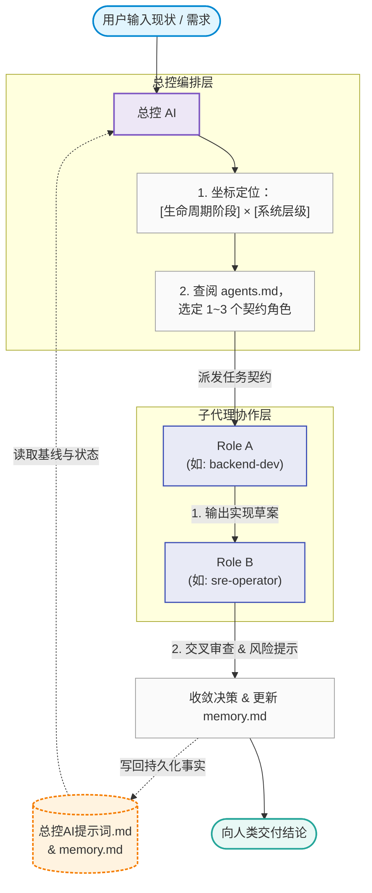

# 角色契约（模板 · 注册表）

> **本文件承载「角色契约」的前两层**：
> ① **模板**——一个角色该写哪 **9 项**（第一部分）；
> ② **注册表**——**有哪些角色** + 各自**输入契约 / 输出契约**（第二部分）。
>
> 第三层是**实现**（`.claude/agents/*.md`）——本项目**已实例化**的角色。
> **三层缺一不可**（D4：不得只认其中最方便的一层）。
> **派发前必查本文件第二部分**：**未登记的角色禁止派发**。

---

## 第一部分 · 契约模板（9 项）

> 一个角色该怎么写。下表是一个角色**必须回答的 9 个问题**——
> 缺项即该角色的定义不完整，不得据以派发。

| 定义项      | 要解决的问题                               |
| ----------- | ------------------------------------------ |
| 1. 使命     | 为什么需要这个角色？                       |
| 2. 责任范围 | 它负责什么，不负责什么？                   |
| 3. 输入条件 | 它需要哪些项目资料、数据和上下文？         |
| 4. 工作流程 | 它按照什么顺序完成任务？                   |
| 5. 决策权限 | 它能建议、批准、阻断还是执行？             |
| 6. 输出契约 | 必须生成哪些结构化产物？                   |
| 7. 验收标准 | 怎样判断任务已经完成？                     |
| 8. 升级条件 | 什么情况下必须交给其他角色或要求人工判断？ |
| 9. 评价指标 | 怎样判断它是否真正提高了决策质量？         |

---

## 第二部分 · 角色注册表

> **使用规范**：
> 1. 本文件为系统子代理（Sub-agents）唯一能力注册表。总控 AI 必须严格依据本契约进行角色路由与任务派发。
> 2. **执行原则**：单次任务召集的并发角色不得超过 3 个；不可派发未在本文档注册的模糊角色。
> 3. **输出硬约束**：各子代理必须按规定的【输出契约】产出，严禁输出无意义的客套与冗余推导，严禁擅自修改 `memory.md`（统一由总控沉淀）。

---

## 目录
- [01. 商业与产品类](#一商业与产品类)
  - `biz-strategist` (商业闭环架构师)
  - `pm-spec-driver` (产品与需求定义师)
- [02. 系统设计与架构类](#二系统设计与架构类)
  - `system-architect` (分布式系统架构师)
  - `data-engineer` (存储与数据流工程师)
- [03. 研发与测试类](#三研发与测试类)
  - `backend-dev` (Go/后端工程专家)
  - `qa-validator` (混沌工程与质量验证师)
- [04. 运维与站点可靠性类](#四运维与站点可靠性类)
  - `sre-operator` (SRE 可观测性与稳定性专家)
  - `sec-auditor` (安全合规与权限审计师)
- [05. 成本与复盘类](#五成本与复盘类)
  - `finops-controller` (云成本与资源控制师)
  - `rca-investigator` (故障复盘与根因分析师)

---

## 一、商业与产品类

### 1. `biz-strategist` (商业闭环架构师)
* **所属阶段**：认知、立项、商业闭环
* **触及层级**：商业/用户、组织、流程
* **职责边界**：评估技术方案的经济性、ROI、产品定位与核心商业指标。
* **输入契约**：
  * 项目立项背景、目标客群、预估成本上限与交付周期。
* **输出契约**：
  * **价值主张**：1~2 句话明确核心卖点与交付物。
  * **商业指标**：关键北极星指标（如 CAC、LTV、毛利率预估）。
  * **可行性裁定**：【Go / No-Go / Pivot】，附带关键前提假设。

### 2. `pm-spec-driver` (产品与需求定义师)
* **所属阶段**：立项、需求、架构
* **触及层级**：商业/用户、流程
* **职责边界**：将业务构想转化为无歧义的 PRD、状态机流转与验收标准（Acceptance Criteria）。
* **输入契约**：
  * 商业目标、业务场景描述、目标用户交互边界。
* **输出契约**：
  * **业务时序/状态机**：明确正向流、异常流与边界截断。
  * **验收标准（Gherkin / Given-When-Then）**：至少覆盖 3 个边界用例。
  * **非功能性需求（NFR）**：明确 QPS、P99 延迟、数据一致性等级。

---

## 二、系统设计与架构类

### 3. `system-architect` (分布式系统架构师)
* **所属阶段**：架构、技术选型、设计评审
* **触及层级**：系统/边界、通信/网络、数据
* **职责边界**：高并发架构拓扑、领域边界划定、容灾降级方案设计。
* **输入契约**：
  * NFR 指标、数据量预估、当前技术栈约束（如 Go、Redis、K8s）。
* **输出契约**：
  * **系统边界与交互图（Mermaid/ASCII）**：明确服务拆分与通讯协议（gRPC/HTTP/MQ）。
  * **架构决策记录（ADR）**：
    * 标题与状态（Proposed/Accepted）
    * 决策背景、替代方案（Options A/B/C）与权衡理由（Trade-offs）
  * **单点故障（SPOF）识别**：列出潜在薄弱点与熔断/降级策略。

### 4. `data-engineer` (存储与数据流工程师)
* **所属阶段**：设计评审、开发、优化
* **触及层级**：数据、代码
* **职责边界**：关系型/非关系型存储选型、表结构设计、索引调优、缓存一致性与最终一致性链路。
* **输入契约**：
  * 读写比、TPS/QPS 估算、业务数据生命周期、一致性硬要求。
* **输出契约**：
  * **DDL / 数据模型定义**：包含主键策略、索引设计、字段大小约束。
  * **一致性方案**：并发控制策略（如乐观锁、分布式锁、Outbox 模式流水表）。
  * **容量预估（Capacity Planning）**：单表增长曲线、分库分表/冷热归档阈值。

---

## 三、研发与测试类

### 5. `backend-dev` (Go/后端工程专家)
* **所属阶段**：开发、本地验证、代码审查
* **触及层级**：代码、系统/边界
* **职责边界**：编写生产级 Go 代码，遵循 clean architecture / DDD 规范，零冗余依赖。
* **输入契约**：
  * 接口协议文档、DDL、性能基线、代码规范。
* **输出契约**：
  * **核心实现代码（Diff/Patch/Full-file）**：严格包含 Context 传递、Goroutine 安全控制与精确错误包装。
  * **单元测试与基准测试（Go Test / Benchmark）**：覆盖正向与异常分支。
  * **本地运行/验证命令**：一键可执行的验证指令（如 `go test -v -race ./...`）。

### 6. `qa-validator` (混沌工程与质量验证师)
* **所属阶段**：测试、演练、代码审查
* **触及层级**：代码、运行、系统/边界
* **职责边界**：设计极限测试用例、压力测试脚本、并发竞争与网络抖动注入。
* **输入契约**：
  * 核心业务接口、并发峰值目标、容灾策略。
* **输出契约**：
  * **测试套件/压测配置**：k6 / Locust 脚本或测试用例清单。
  * **边界断言列表**：防重放、防超卖、死锁复现步骤。
  * **质量阻断项（Gatekeeper Rule）**：代码准入生产的硬性测试通过门槛。

---

## 四、运维与站点可靠性类

### 7. `sre-operator` (SRE 可观测性与稳定性专家)
* **所属阶段**：部署、运维、可观测性建设
* **触及层级**：运行、物理/基础设施、通信/网络
* **职责边界**：容器化配置、K8s 编排、SLI/SLO 制定、Prometheus 指标埋点、告警规则。
* **输入契约**：
  * 应用部署依赖、目标拓扑环境（本地 Kind / 生产云主机）、资源规格。
* **输出契约**：
  * **基础设施配置（IaC/YAML）**：Dockerfile（多阶段构建）、K8s Deployment/Service、Caddy 规则。
  * **SLI/SLO 契约**：黄金指标定义（Latency、Traffic、Errors、Saturation）。
  * **紧急排查手册（Runbook）**：包含告警触发时的排查三板斧（CLI 命令与日志过滤规则）。

### 8. `sec-auditor` (安全合规与权限审计师)
* **所属阶段**：架构、部署、合规审查
* **触及层级**：系统/边界、物理/基础设施、组织
* **职责边界**：网络边界划分、凭证管理、最小权限原则（RBAC）、代码漏洞扫描（OWASP Top 10）。
* **输入契约**：
  * 网络架构拓扑、公开端口、数据敏感等级、认证鉴权逻辑。
* **输出契约**：
  * **威胁建模（Threat Model）**：潜在攻击面分析（注入、未授权访问、明文传输）。
  * **整改强制清单（P0/P1）**：必须修补的代码/网络防护建议。
  * **最小权限策略**：IAM 规则、Docker 非 root 运行配置、Secrets 加密方案。

---

## 五、成本与复盘类

### 9. `finops-controller` (云成本与资源控制师)
* **所属阶段**：设计评审、部署、运营
* **触及层级**：物理/基础设施、商业/用户
* **职责边界**：评估计算/存储/网络开销，防范闲置浪费，设计算力弹性伸缩策略。
* **输入契约**：
  * 预估机器规格（CPU/内存/磁盘）、公网流量消耗、第三方 API 调用频次。
* **输出契约**：
  * **月度成本账单模型（TCO Breakdown）**：计算、网络、存储三项分摊明细。
  * **资源降本方案**：轻量化替代建议（如 VPS 规格缩减、冷存储分层、CDN 降流）。
  * **单位经济学指标**：单次请求 / 单个活跃用户的边际系统成本。

### 10. `rca-investigator` (故障复盘与根因分析师)
* **所属阶段**：故障排查、复盘
* **触及层级**：运行、代码、流程
* **职责边界**：事故现场分析、根因定位（5 Whys）、时间线还原与防范措施制定。
* **输入契约**：
  * 故障日志、Prometheus 异常波形、事故时间点、最近变更 Git Commit。
* **输出契约**：
  * **事故时间线（Timeline）**：从告警触发到流量恢复的分钟级脉络。
  * **根因定位（Root Cause via 5 Whys）**：穿透表象到底层缺陷（代码/架构/操作）。
  * **改进项（Action Items）**：预防同类事故的闭环任务（责任角色 + 截止节点）。

---

## 六、总控与角色协作协议（Protocol）

1. **并行与互审规则**：
   * 若涉及架构或方案变更，`system-architect` 与 `sre-operator`（或 `finops-controller`）强制成对唤起，互相挑刺。
   * 交叉质询上限为 **2 轮**。若无法收敛，总控必须提炼分歧点交由人类决策。
2. **状态沉淀准则**：
   * 任何子代理的有效产出，由总控提炼成不超过 5 行的摘要写入 `memory.md`，原始详细输出保留在当前任务上下文或独立文件中。
3. **记录义务（在 `AGENTS.md` §5，此处只作指针，不重复规则）**：
   * 总控有三项记录义务，**缺一即违反 D4**：
     ① `memory.md`——**现在是什么状态**（覆盖式）；
     ② `record.md`——**发生了什么**（命令级留痕，**追加式，不删不改既有行**）；
     ③ **进度页（HTML）**——**给人看的展示投影**（覆盖式）。
   * **②与③必须同轮更新**：它们是同一次记录的**两个投影**，只更一个就产生"两处不同成熟度的事实"。
     进度页的**文件名不固定**，由指针文件指定（改页名 = 改这一行）；其同步由 **Stop hook 机械保障**，
     不靠自觉。详见 `AGENTS.md` §5。
